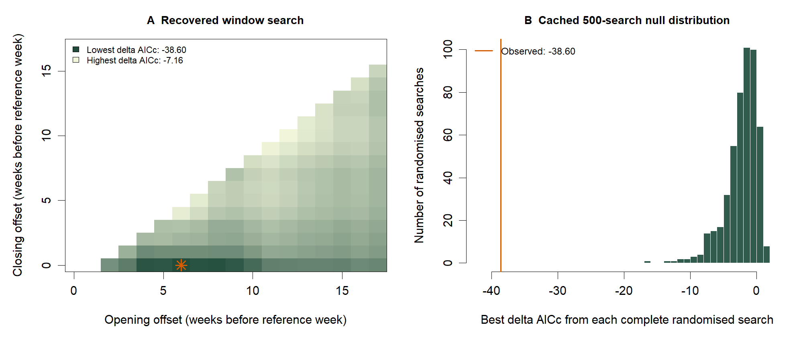

## Data preparation

Annual median laying date (45 seasons) and daily SMHI temperature. The original script starts from the private bird file; the public annual input reproduces its response summary.

<details class="analysis-code" open>
<summary>Show R code</summary>

```r
annual <- read.csv("data_derived/annual_raw_median_laying_date.csv")
weather <- read.csv("data_derived/smhi_hoburg_daily_temperature.csv")
cache <- readRDS("cache/climwin/recovered_search_data.rds")
stopifnot(nrow(annual) == 45L, nrow(cache$randomised) == 500L)
```

</details>

## Original search code

Recovered from the original `CF_thermal_phenology` project, copied unchanged. The search and 500 randomised searches are **not executed during rendering**.

<details class="analysis-code">
<summary>Show original script: slidingwin, randwin and historical validation</summary>



</details>

[Download original R script](R/04_climwin_laying_date.R) · [Download aggregate RDS cache](cache/climwin/recovered_search_data.rds)

## Read the cached search results

<details class="analysis-code" open>
<summary>Show R code</summary>

```r
# Match the original selection rule: boundary difference at least two weeks.
x <- cache$main$Dataset
eligible <- subset(x, WindowOpen - WindowClose >= 2)
best <- eligible[which.min(eligible$deltaAICc), ]
best[, c("WindowOpen", "WindowClose", "deltaAICc", "ModelBeta")]
read.csv("tables/climwin_recovered/selected_windows_audit.csv")
```

</details>

| analysis | open_weeks | close_weeks | delta_AICc | temperature_beta | n_days |
| --- | --- | --- | --- | --- | --- |
| main | 6 | 0 | -38.6016 | -3.44925 | 49 |
| first23 | 9 | 0 | -19.8915 | -3.30513 | 70 |
| second22 | 4 | 1 | -8.47412 | -2.04377 | 28 |

[Download selected-window output](tables/climwin_recovered/selected_windows_audit.csv) · [All candidate windows](tables/climwin_recovered/candidate_windows.csv)

The main 6–0-week search window contains **49 days**: 26 March–13 May in non-leap years, 25 March–12 May in leap years. The reproductive models retain their separate operational **26 March–7 May (43-day)** exposure.

## Full-search randomisation

<details class="analysis-code" open>
<summary>Show R code</summary>

```r
null <- cache$randomised$deltaAICc
exceedances <- sum(null <= best$deltaAICc)
p_plus_one <- (exceedances + 1) / (length(null) + 1)
c(exceedances = exceedances, p_plus_one = p_plus_one)
```

</details>

| observed_delta_AICc | repeats | exceedances | plus_one_p | null_min | null_max |
| --- | --- | --- | --- | --- | --- |
| -38.6016 | 500 | 0 | 0.00199601 | -16.9196 | 1.45937 |

[Download 500 cached randomised-search outputs](tables/climwin_recovered/randomised_windows.csv)

The old package output `<0.001` is preserved in the archive; the plus-one empirical probability from **0/500** exceedances is **1/501 = 0.001996**.

## Temporal-validation check

The archived `singlewin` call used a different exposure series and returned +0.370 days/°C. The separate audit below reconstructs the complete-week bins and verifies the main, training and second-period slopes against the cached search output before evaluating the held-out years. It does not repeat the search.

<details class="analysis-code">
<summary>Show recovery audit code: weekly bins, cached checks and held-out validation</summary>



</details>

<details class="analysis-code">
<summary>Show R code</summary>

```r
audit <- readRDS("cache/climwin/recovery_audit_results.rds")
audit$temporal_validation
```

</details>

| training_seasons | held_out_seasons | training_beta | held_out_beta | held_out_CI_low | held_out_CI_high |
| --- | --- | --- | --- | --- | --- |
| 23 | 22 | -3.30513 | -1.56553 | -2.734 | -0.397058 |

| prediction_RMSE | baseline_RMSE | prediction_bias |
| --- | --- | --- |
| 3.18671 | 5.22643 | 1.52055 |

[Download validation output](tables/climwin_recovered/temporal_validation_audit.csv) · [Compare old and reconstructed exposures](tables/climwin_recovered/legacy_exposure_comparison.csv) · [Annual weekly inputs](tables/climwin_recovered/annual_weekly_exposure.csv)

<details class="analysis-code">
<summary>Original archived outputs and provenance</summary>

The historical files are retained unchanged; they are not substituted for the checked validation above.

- [Original window-selection table](tables/climwin_recovered/archive/climwin_windows.csv): calendar labels express offsets from 7 May, rather than all days in the complete-week bins.
- [Original false-positive table](tables/climwin_recovered/archive/climwin_false_positive_tests.csv).
- [Original out-of-sample table](tables/climwin_recovered/archive/climwin_out_of_sample.csv): historical +0.370 result.
- [Original temperature-effect table](tables/climwin_recovered/archive/climwin_temperature_effects.csv).
- [Original settings](tables/climwin_recovered/archive/climwin_settings.csv) and [median-window boundaries](tables/climwin_recovered/archive/climwin_medwin.csv).
- [Recovery provenance and source checksums](tables/climwin_recovered/recovery_provenance.json).
- [Recovery-audit session information](tables/climwin_recovered/recovery_session_info.txt).

The public RDS contains aggregate search data extracted from the original caches; fitting environments and individual field records are excluded.

</details>

## Figure



[PDF](figures/Fig_climwin_recovered.pdf) · [Figure code — final chapter](figure_code.qmd#sliding-window-diagnostics)

## Main conclusions

- The selected complete-week window associates warmer springs with earlier annual laying dates.
- None of the 500 cached randomised searches was as extreme as the observed result.
- The negative association persists in held-out years when the training window's complete-week exposure is used; this does not independently validate reproductive models.
