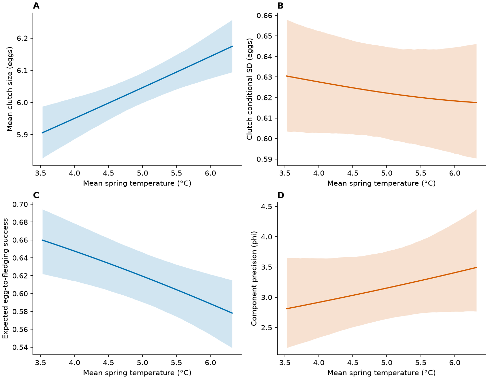

[Data](data_derived/analysis/clutch_model_data.csv) · [Refit](workflow.qmd#refit-from-the-public-model-data) · [Full summaries](full_summaries.qmd#clutch-size)

## Data preparation

<details class="analysis-code">
<summary>Show R code</summary>

```r
out <- "models/within_between_20261026"
d <- read.csv("data_derived/analysis/clutch_model_data.csv")
m <- readRDS(file.path(out, "clutch_baseline_selected.rds")) # after the public runner
```

</details>

::: {#result-clutch_size-1 .analysis-result}

**Result**

| trait | records | females | seasons | females_varied_temperature |
| --- | --- | --- | --- | --- |
| clutch | 12627 | 8894 | 44 | 2547 |
| fledging | 9790 | 7132 | 39 | 1908 |

[Download complete results (CSV)](tables/within_between_20261026/sample_metadata.csv)

:::

## Fit and verify the single-temperature model

<details class="analysis-code">
<summary>Historical verification code (provenance)</summary>



</details>

::: {#result-clutch_size-2 .analysis-result}

**Result**

| component | term | estimate | SE | lower | upper |
| --- | --- | --- | --- | --- | --- |
| cond | (Intercept) | 1.8015 | 0.00397308 | 1.79371 | 1.80929 |
| cond | rel_LD | -0.00841514 | 0.000245586 | -0.00889648 | -0.0079338 |
| cond | temp_mean_c | 0.0159318 | 0.00395571 | 0.00817875 | 0.0236848 |
| cond | year_c | 0.00090279 | 0.000330135 | 0.000255736 | 0.00154984 |
| cond | age_classOLD | 0.0299908 | 0.00237729 | 0.0253313 | 0.0346502 |
| disp | (Intercept) | -2.81497 | 0.0338217 | -2.88126 | -2.74868 |
| disp | rel_LD | 0.0527507 | 0.00292108 | 0.0470254 | 0.0584759 |
| disp | temp_mean_c | -0.0262978 | 0.0178672 | -0.0613168 | 0.00872117 |
| disp | year_c | 0.00249383 | 0.0016643 | -0.000768125 | 0.00575579 |
| disp | age_classOLD | -0.125861 | 0.0360049 | -0.196429 | -0.0552926 |

[Download complete results (CSV)](tables/within_between_20261026/fixed_effects.csv)

:::

[Download fitting script](R/75_verify_COM_Poisson.R)

| row | code | pdHess | logLik | scaled_gradient | bound_distance |
| --- | --- | --- | --- | --- | --- |
| nlminb | 0 | TRUE | -13769 | 0.00020724 | 0.28087 |
| LBFGS | 0 | TRUE | -13769 | 0.00019347 | 0.28087 |

[Download CSV](tables/final_models_20261019/COM_final_diagnostics.csv)

[Full validated R summary](tables/reproduction_checks/model_summaries/clutch_baseline.txt) · [Public-data refit instructions](workflow.qmd#refit-from-the-public-model-data)

## Export predictions from the saved fit

<details class="analysis-code">
<summary>Show prediction-export script (run locally)</summary>



</details>

::: {#result-clutch_size-3 .analysis-result}

**Result**

| x | age_class | estimate | CI_low | CI_high |
| --- | --- | --- | --- | --- |
| 3.52791 | YOUNG | 5.90581 | 5.82622 | 5.98768 |
| 3.55136 | YOUNG | 5.90801 | 5.82962 | 5.98896 |
| 3.57481 | YOUNG | 5.91022 | 5.83314 | 5.99004 |
| 3.59826 | YOUNG | 5.91243 | 5.83583 | 5.99158 |
| 3.62171 | YOUNG | 5.91464 | 5.83885 | 5.993 |

[Download complete results (CSV)](tables/final_models_20261019/COM_temperature_mean.csv)

:::

[Download prediction-export script](R/76_export_COM_predictions.R)



[Result](#result-clutch_size-2)

<details class="analysis-code">
<summary>Show R code</summary>

```r
fixed <- read.csv("tables/final_models_20261019/count_coefficients.csv")
temperature <- read.csv("tables/final_models_20261019/COM_temperature_mean.csv")
fixed
head(temperature)
```

</details>

[Result](#result-clutch_size-2)

<details class="analysis-code">
<summary>Show saved output: count_coefficients.csv</summary>

| model | component | term | estimate | SE | lower | upper |
| --- | --- | --- | --- | --- | --- | --- |
| Poisson | cond | (Intercept) | 1.8041 | 0.0072243 | 1.7899 | 1.8183 |
| Poisson | cond | rel_LD | -0.0091874 | 0.0007333 | -0.010625 | -0.0077502 |
| Poisson | cond | temp_mean_c | 0.012959 | 0.0046411 | 0.0038621 | 0.022055 |
| Poisson | cond | year_c | 0.0011838 | 0.00042043 | 0.00035973 | 0.0020078 |
| Poisson | cond | age_classOLD | 0.029299 | 0.0081295 | 0.013365 | 0.045233 |
| COM_Poisson | cond | (Intercept) | 1.8015 | 0.0039731 | 1.7937 | 1.8093 |
| COM_Poisson | cond | rel_LD | -0.0084151 | 0.00024559 | -0.0088965 | -0.0079338 |
| COM_Poisson | cond | temp_mean_c | 0.015931 | 0.0039557 | 0.0081783 | 0.023685 |
| COM_Poisson | cond | year_c | 0.00090282 | 0.00033014 | 0.00025575 | 0.0015499 |
| COM_Poisson | cond | age_classOLD | 0.029991 | 0.0023773 | 0.025331 | 0.03465 |
| COM_Poisson | disp | (Intercept) | -2.815 | 0.033822 | -2.8813 | -2.7487 |
| COM_Poisson | disp | rel_LD | 0.052751 | 0.0029211 | 0.047025 | 0.058476 |
| COM_Poisson | disp | temp_mean_c | -0.026297 | 0.017867 | -0.061317 | 0.0087223 |
| COM_Poisson | disp | year_c | 0.0024938 | 0.0016643 | -0.00076827 | 0.0057558 |
| COM_Poisson | disp | age_classOLD | -0.12586 | 0.036005 | -0.19643 | -0.05529 |

[Download CSV](tables/final_models_20261019/count_coefficients.csv)

</details>

| x | age_class | estimate | CI_low | CI_high |
| --- | --- | --- | --- | --- |
| 3.5279 | YOUNG | 5.9058 | 5.8262 | 5.9877 |
| 3.5514 | YOUNG | 5.908 | 5.8296 | 5.989 |
| 3.5748 | YOUNG | 5.9102 | 5.8331 | 5.99 |
| 3.5983 | YOUNG | 5.9124 | 5.8358 | 5.9916 |
| 3.6217 | YOUNG | 5.9146 | 5.8388 | 5.993 |

[Download CSV](tables/final_models_20261019/COM_temperature_mean.csv)

## Figure



[PDF](figures/Fig3_COM_M1_temperature.pdf) · [Figure code — final chapter](figure_code.qmd#temperature-date-and-age)

## Main conclusions

- Warmer springs: larger clutches; association with clutch-size consistency uncertain.
- Later laying: smaller and more variable clutches. Older females: larger and more consistent clutches.
- COM-Poisson improved on Poisson, but conditional variance and some count frequencies remained imperfectly reproduced.

<details class="method-notes">
<summary>Method notes</summary>

**Sample check.** Clutch size: 12,627 attempts, 8,894 females, 44 seasons. Egg-to-fledging success: 9,790 attempts, 7,132 females, 39 seasons. Public model-ready CSVs are available in data_derived/analysis; these counts are the saved analysis-sample metadata.

**Saved model summary.** Warmer springs were associated with larger clutches. The single-temperature consistency association remains uncertain. COM-Poisson dispersion is log inverse shape, not log residual SD. Coefficients below are on the link scale; these are exported estimates, not a fresh model fit. `cond` = location, `disp` = dispersion, `zi` = extra-zero probability.

**Saved prediction output (first five rows).** `estimate` is the reference-condition expected outcome; `CI_low` and `CI_high` are pointwise 95% confidence limits. These are predictions, not model coefficients. Other predictors and random effects are held at the reference values specified in the chapter.

The analysis uses 12,627 clutch records from 8,894 females. [Model-ready records](data_derived/analysis/clutch_model_data.csv) are public. [Run the standalone reproduction pipeline](workflow.qmd#refit-from-the-public-model-data) to generate fitted objects locally.

COM-Poisson location and dispersion use laying date, temperature, year and age. Female and year random intercepts enter location.

The script above is the historical verification workflow. For a clean refit from the public records without historical starting objects, use [R/94_reproduce_from_public_data.R](R/94_reproduce_from_public_data.R).

Both the single-temperature model and the within–between temperature model are reported in the paper. The second formulation and its direct comparison with this model are shown in [Temperature within and between females](within_between.qmd).

</details>
