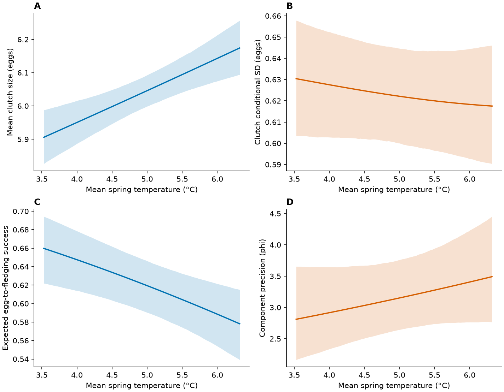
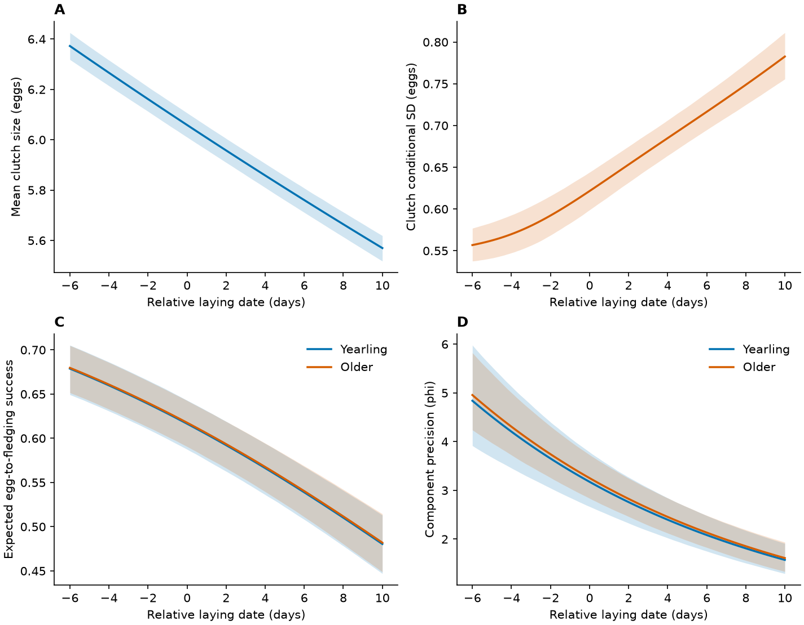
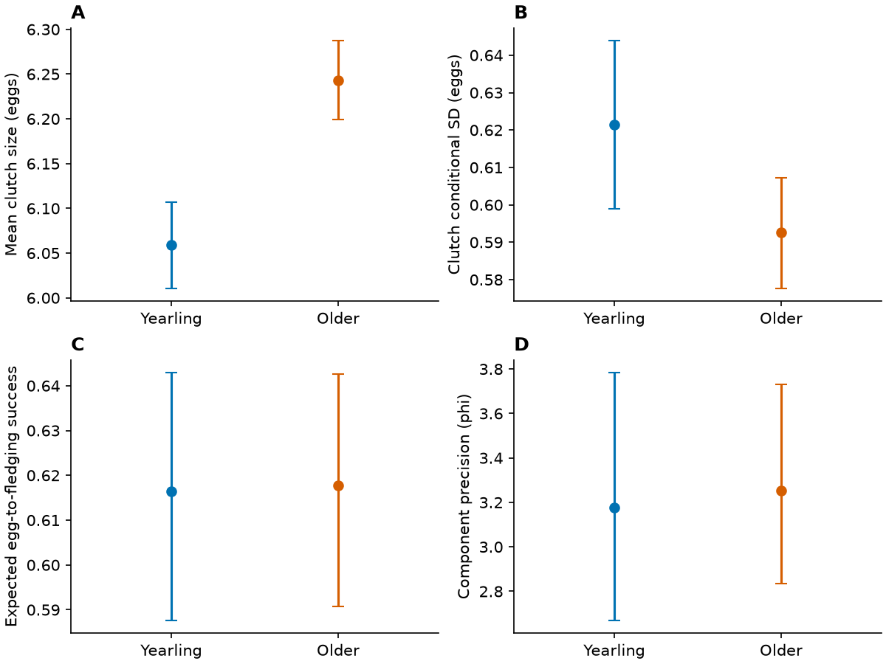
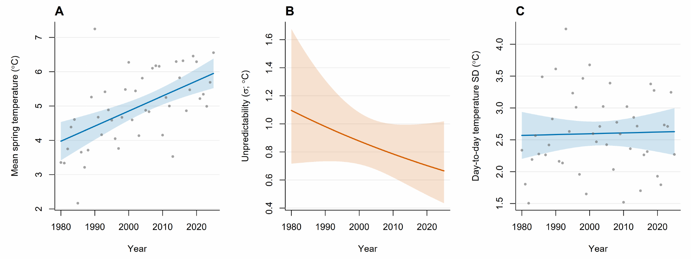

## Files and packages

Download the [repository ZIP](https://github.com/anetaarct/thermal-conditions-reproduction-cf-publication/archive/refs/heads/main.zip). The scripts read CSV prediction tables in `tables/` and write figures to `figures/`; no model fitting is required. Python packages: pandas, matplotlib (and their dependencies).

## Sliding-window diagnostics {#sliding-window-diagnostics}

This new plotting script reads the recovered candidate-window and randomisation CSV files. It does not refit models; base R is sufficient.

<details class="analysis-code">
<summary>Show plotting code: window-search diagnostics</summary>



</details>

```bash
Rscript R/04b_plot_recovered_climwin.R
```


[PDF](figures/Fig_climwin_recovered.pdf)

## Calendar-year trends {#calendar-year-trends}

<details class="analysis-code">
<summary>Show plotting script: plot_temporal_models.py</summary>



</details>

<details class="analysis-code" open>
<summary>Show command</summary>

```bash
python scripts/plot_temporal_models.py
```

</details>


[PDF](figures/Fig4_COM_M1_time.pdf)

## Temperature, date and age {#temperature-date-and-age}

<details class="analysis-code">
<summary>Show plotting script: plot_final_models.py</summary>



</details>

<details class="analysis-code" open>
<summary>Show command</summary>

```bash
python scripts/plot_final_models.py
```

</details>

### Temperature



[PDF](figures/Fig3_COM_M1_temperature.pdf)

### Relative laying date



[PDF](figures/Fig5_COM_M1_date.pdf)

### Female age



[PDF](figures/Fig6_COM_M1_age.pdf)

## Temperature within and between females {#temperature-within-between}

<details class="analysis-code">
<summary>Show plotting code: within–between figures</summary>



</details>

```r
source("R/92_plot_temperature_within_between.R")
```


[PDF](figures/Fig_within_between_clutch.pdf)


[PDF](figures/Fig_within_between_fledging.pdf) · [Model code and saved results](within_between.qmd)

## Spring-temperature figure

<details class="analysis-code">
<summary>Show retained R plotting block</summary>

This block uses `annual`, `plot_data` and `scale_data` produced by the [temperature-model code](model_structure.qmd#spring-temperature-model). It draws the mean and residual-SD panels. The saved publication image also includes a within-window daily-SD panel; the code for assembling that extra panel is not retained here.



</details>



[PDF](figures/Fig2_temperature_location_scale_time.pdf)
