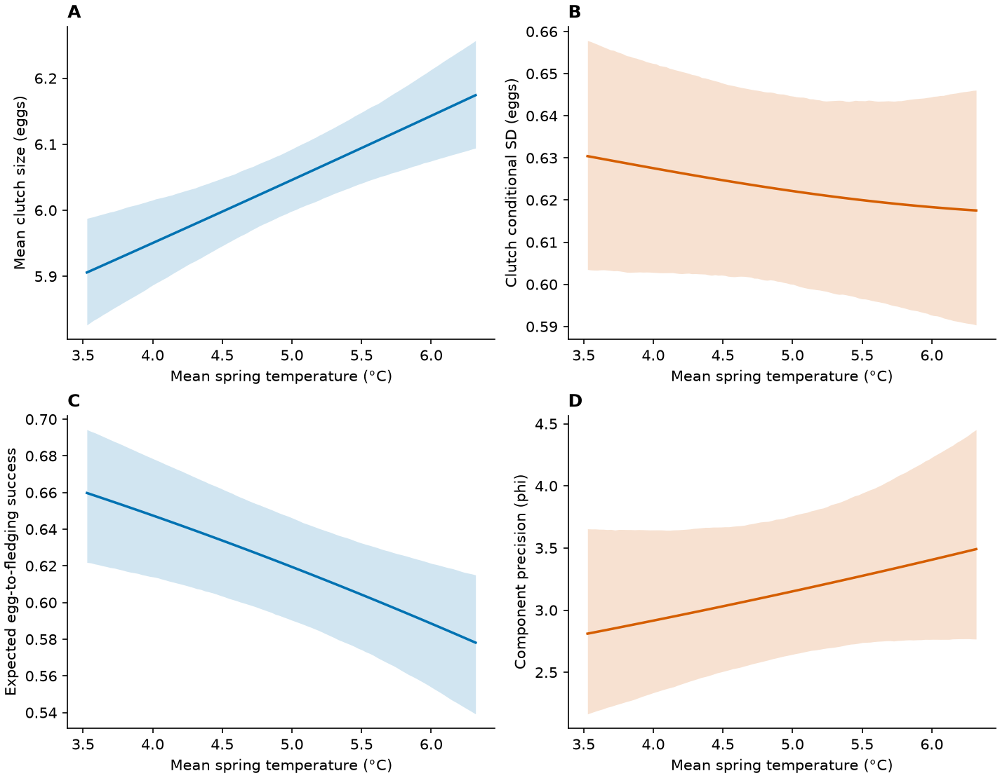

## Data preparation

The analysis uses 9,790 attempts from 7,132 females. [Model-ready records](data_derived/analysis/fledging_model_data.csv) are public. [Run the standalone reproduction pipeline](workflow.qmd#refit-from-the-public-model-data) to generate fitted objects locally.

<details class="analysis-code">
<summary>Show R code</summary>

```r
base <- readRDS("models/within_between_20261026/fledging_baseline_selected.rds") # after the public runner
d <- read.csv("data_derived/analysis/fledging_model_data.csv")
stopifnot(nobs(base) == 9790, base$fit$convergence == 0,
          isTRUE(base$sdr$pdHess))
```

</details>

::: {.callout-note .review-summary appearance="simple"}

## Saved results for this step

**Sample check.** Clutch size: 12,627 attempts, 8,894 females, 44 seasons. Egg-to-fledging success: 9,790 attempts, 7,132 females, 39 seasons. Public model-ready CSVs are available in data_derived/analysis; these counts are the saved analysis-sample metadata.

| trait | records | females | seasons | females_varied_temperature |
| --- | --- | --- | --- | --- |
| clutch | 12627 | 8894 | 44 | 2547 |
| fledging | 9790 | 7132 | 39 | 1908 |

[Download complete results (CSV)](tables/within_between_20261026/sample_metadata.csv)
:::


## Fit and verify the single-temperature model

Zero-inflated beta-binomial, with year random intercepts in location, precision and extra-zero probability; female random intercepts in location.

<details class="analysis-code">
<summary>Historical extension code (provenance)</summary>



</details>

::: {.callout-note .review-summary appearance="simple"}

## Saved results for this step

**Saved model summary.** Warmer springs were associated with lower egg-to-fledging success. Temperature associations with precision remain uncertain. Precision describes the beta-binomial component; it is not full-mixture variance. Coefficients below are on the link scale; these are exported estimates, not a fresh model fit. `cond` = location, `disp` = dispersion, `zi` = extra-zero probability.

| component | term | estimate | SE | lower | upper |
| --- | --- | --- | --- | --- | --- |
| cond | (Intercept) | 1.08286 | 0.0664973 | 0.952525 | 1.21319 |
| cond | rel_LD | -0.0751094 | 0.00456819 | -0.0840629 | -0.0661559 |
| cond | age_classOLD | 0.00745227 | 0.044841 | -0.0804346 | 0.0953391 |
| cond | temp_mean_c | -0.190955 | 0.059702 | -0.307969 | -0.0739412 |
| cond | year_c | -0.00860357 | 0.00572649 | -0.0198273 | 0.00262014 |
| zi | (Intercept) | -1.55237 | 0.0930571 | -1.73476 | -1.36998 |
| disp | (Intercept) | 1.15545 | 0.0904679 | 0.978135 | 1.33276 |
| disp | rel_LD | -0.0702219 | 0.0069397 | -0.0838234 | -0.0566203 |
| disp | age_classOLD | 0.0239467 | 0.0844113 | -0.141496 | 0.18939 |
| disp | temp_mean_c | 0.0776495 | 0.0643088 | -0.0483935 | 0.203692 |
| disp | year_c | -0.0106886 | 0.0063209 | -0.0230773 | 0.00170017 |

[Download complete results (CSV)](tables/within_between_20261026/fixed_effects.csv)
:::


The script above is the historical extension workflow. For a clean refit from the public records without historical starting objects, use [R/94_reproduce_from_public_data.R](R/94_reproduce_from_public_data.R).

[Download fitting script](R/81_fit_ZIyear_fledging.R)

| model | n | logLik | AIC | convergence | pdHess | scaled_gradient |
| --- | --- | --- | --- | --- | --- | --- |
| ZI_year_primary_ML | 9790 | -16632 | 33294 | 0 | TRUE | 0.00036322 |

[Download CSV](tables/primary_ZIyear_ML_20261021/ZIyear_diagnostics.csv)

[Full validated R summary](tables/reproduction_checks/model_summaries/fledging_baseline.txt) · [Public-data refit instructions](workflow.qmd#refit-from-the-public-model-data)

## Export predictions from the saved fit

<details class="analysis-code">
<summary>Show prediction-export script (run locally)</summary>



</details>

::: {.callout-note .review-summary appearance="simple"}

## Saved results for this step

**Saved prediction output (first five rows).** `estimate` is the reference-condition expected outcome; `CI_low` and `CI_high` are pointwise 95% confidence limits. These are predictions, not model coefficients. Other predictors and random effects are held at the reference values specified in the chapter.

| x | age_class | estimate | CI_low | CI_high |
| --- | --- | --- | --- | --- |
| -1.57069 | YOUNG | 0.659743 | 0.621865 | 0.694275 |
| -1.5425 | YOUNG | 0.65903 | 0.621595 | 0.693344 |
| -1.51431 | YOUNG | 0.658314 | 0.62102 | 0.69256 |
| -1.48612 | YOUNG | 0.657596 | 0.620572 | 0.691627 |
| -1.45793 | YOUNG | 0.656876 | 0.620023 | 0.690662 |

[Download complete results (CSV)](tables/primary_ZIyear_ML_20261021/ZIyear_temperature_success.csv)
:::


[Download prediction-export script](R/82_export_ZIyear_primary.R)



::: {.callout-note .review-summary appearance="simple"}

## Saved results for this step

**Saved model summary.** Warmer springs were associated with lower egg-to-fledging success. Temperature associations with precision remain uncertain. Precision describes the beta-binomial component; it is not full-mixture variance. Coefficients below are on the link scale; these are exported estimates, not a fresh model fit. `cond` = location, `disp` = dispersion, `zi` = extra-zero probability.

| component | term | estimate | SE | lower | upper |
| --- | --- | --- | --- | --- | --- |
| cond | (Intercept) | 1.08286 | 0.0664973 | 0.952525 | 1.21319 |
| cond | rel_LD | -0.0751094 | 0.00456819 | -0.0840629 | -0.0661559 |
| cond | age_classOLD | 0.00745227 | 0.044841 | -0.0804346 | 0.0953391 |
| cond | temp_mean_c | -0.190955 | 0.059702 | -0.307969 | -0.0739412 |
| cond | year_c | -0.00860357 | 0.00572649 | -0.0198273 | 0.00262014 |
| zi | (Intercept) | -1.55237 | 0.0930571 | -1.73476 | -1.36998 |
| disp | (Intercept) | 1.15545 | 0.0904679 | 0.978135 | 1.33276 |
| disp | rel_LD | -0.0702219 | 0.0069397 | -0.0838234 | -0.0566203 |
| disp | age_classOLD | 0.0239467 | 0.0844113 | -0.141496 | 0.18939 |
| disp | temp_mean_c | 0.0776495 | 0.0643088 | -0.0483935 | 0.203692 |
| disp | year_c | -0.0106886 | 0.0063209 | -0.0230773 | 0.00170017 |

[Download complete results (CSV)](tables/within_between_20261026/fixed_effects.csv)
:::


<details class="analysis-code">
<summary>Show R code</summary>

```r
fixed <- read.csv("tables/primary_ZIyear_ML_20261021/ZIyear_fixed.csv")
pred <- read.csv("tables/primary_ZIyear_ML_20261021/ZIyear_temperature_success.csv")
fixed
head(pred)
```

</details>

::: {.callout-note .review-summary appearance="simple"}

## Saved results for this step

**Saved model summary.** Warmer springs were associated with lower egg-to-fledging success. Temperature associations with precision remain uncertain. Precision describes the beta-binomial component; it is not full-mixture variance. Coefficients below are on the link scale; these are exported estimates, not a fresh model fit. `cond` = location, `disp` = dispersion, `zi` = extra-zero probability.

| component | term | estimate | SE | lower | upper |
| --- | --- | --- | --- | --- | --- |
| cond | (Intercept) | 1.08286 | 0.0664973 | 0.952525 | 1.21319 |
| cond | rel_LD | -0.0751094 | 0.00456819 | -0.0840629 | -0.0661559 |
| cond | age_classOLD | 0.00745227 | 0.044841 | -0.0804346 | 0.0953391 |
| cond | temp_mean_c | -0.190955 | 0.059702 | -0.307969 | -0.0739412 |
| cond | year_c | -0.00860357 | 0.00572649 | -0.0198273 | 0.00262014 |
| zi | (Intercept) | -1.55237 | 0.0930571 | -1.73476 | -1.36998 |
| disp | (Intercept) | 1.15545 | 0.0904679 | 0.978135 | 1.33276 |
| disp | rel_LD | -0.0702219 | 0.0069397 | -0.0838234 | -0.0566203 |
| disp | age_classOLD | 0.0239467 | 0.0844113 | -0.141496 | 0.18939 |
| disp | temp_mean_c | 0.0776495 | 0.0643088 | -0.0483935 | 0.203692 |
| disp | year_c | -0.0106886 | 0.0063209 | -0.0230773 | 0.00170017 |

[Download complete results (CSV)](tables/within_between_20261026/fixed_effects.csv)
:::


<details class="analysis-code">
<summary>Show saved output: ZIyear_fixed.csv</summary>

| component | term | estimate | SE | lower | upper |
| --- | --- | --- | --- | --- | --- |
| cond | (Intercept) | 1.0829 | 0.066497 | 0.95253 | 1.2132 |
| cond | rel_LD | -0.07511 | 0.0045682 | -0.084063 | -0.066157 |
| cond | age_classOLD | 0.0074456 | 0.044841 | -0.080441 | 0.095332 |
| cond | temp_mean_c | -0.19096 | 0.059702 | -0.30797 | -0.073942 |
| cond | year_c | -0.0086032 | 0.0057265 | -0.019827 | 0.0026205 |
| zi | (Intercept) | -1.5524 | 0.093054 | -1.7348 | -1.37 |
| disp | (Intercept) | 1.1555 | 0.09047 | 0.97815 | 1.3328 |
| disp | rel_LD | -0.070223 | 0.0069397 | -0.083825 | -0.056621 |
| disp | age_classOLD | 0.023935 | 0.084412 | -0.14151 | 0.18938 |
| disp | temp_mean_c | 0.077644 | 0.064312 | -0.048404 | 0.20369 |
| disp | year_c | -0.010688 | 0.0063211 | -0.023077 | 0.0017014 |

[Download CSV](tables/primary_ZIyear_ML_20261021/ZIyear_fixed.csv)


</details>

| x | age_class | estimate | CI_low | CI_high |
| --- | --- | --- | --- | --- |
| -1.5707 | YOUNG | 0.65974 | 0.62186 | 0.69427 |
| -1.5425 | YOUNG | 0.65903 | 0.6216 | 0.69334 |
| -1.5143 | YOUNG | 0.65831 | 0.62102 | 0.69256 |
| -1.4861 | YOUNG | 0.6576 | 0.62057 | 0.69163 |
| -1.4579 | YOUNG | 0.65688 | 0.62002 | 0.69066 |

[Download CSV](tables/primary_ZIyear_ML_20261021/ZIyear_temperature_success.csv)
<details class="analysis-code">
<summary>Show saved output: simulation_checks.csv</summary>

| model | target | group | level | n | statistic | observed | predicted | lower | upper |
| --- | --- | --- | --- | --- | --- | --- | --- | --- | --- |
| Current_ML | conditional_plugin | overall | all | 9790 | mean_fraction | 0.58607 | 0.57868 | 0.57137 | 0.58614 |
| Current_ML | conditional_plugin | overall | all | 9790 | zero_fraction | 0.23647 | 0.22524 | 0.21726 | 0.23371 |
| Current_ML | conditional_plugin | overall | all | 9790 | complete_success | 0.28856 | 0.28622 | 0.27793 | 0.29479 |
| Current_ML | conditional_plugin | overall | all | 9790 | variance_fraction | 0.15455 | 0.15133 | 0.14907 | 0.1537 |
| Current_ML | new_groups_plugin | overall | all | 9790 | mean_fraction | 0.58607 | 0.58465 | 0.55988 | 0.60644 |
| Current_ML | new_groups_plugin | overall | all | 9790 | zero_fraction | 0.23647 | 0.21568 | 0.20245 | 0.22994 |
| Current_ML | new_groups_plugin | overall | all | 9790 | complete_success | 0.28856 | 0.29049 | 0.25381 | 0.32249 |
| Current_ML | new_groups_plugin | overall | all | 9790 | variance_fraction | 0.15455 | 0.14873 | 0.14324 | 0.15387 |
| ZI_year | conditional_plugin | overall | all | 9790 | mean_fraction | 0.58607 | 0.58094 | 0.57376 | 0.58866 |
| ZI_year | conditional_plugin | overall | all | 9790 | zero_fraction | 0.23647 | 0.23176 | 0.22339 | 0.24004 |
| ZI_year | conditional_plugin | overall | all | 9790 | complete_success | 0.28856 | 0.28586 | 0.27712 | 0.29449 |
| ZI_year | conditional_plugin | overall | all | 9790 | variance_fraction | 0.15455 | 0.15191 | 0.14962 | 0.1543 |
| ZI_year | new_groups_plugin | overall | all | 9790 | mean_fraction | 0.58607 | 0.58639 | 0.55829 | 0.61511 |
| ZI_year | new_groups_plugin | overall | all | 9790 | zero_fraction | 0.23647 | 0.2212 | 0.19325 | 0.24997 |
| ZI_year | new_groups_plugin | overall | all | 9790 | complete_success | 0.28856 | 0.28786 | 0.25811 | 0.31768 |
| ZI_year | new_groups_plugin | overall | all | 9790 | variance_fraction | 0.15455 | 0.14907 | 0.14096 | 0.15661 |

[Download complete CSV](tables/primary_ZIyear_ML_20261021/simulation_checks.csv)

</details>

## Figure

Both the single-temperature model and the within–between temperature model are reported in the paper. The second formulation and its direct comparison with this model are shown in [Temperature within and between females](within_between.qmd).



[PDF](figures/Fig3_COM_M1_temperature.pdf) · [Figure code — final chapter](figure_code.qmd#temperature-date-and-age)

## Main conclusions

- Warmer springs: lower success; temperature association with precision uncertain.
- Later laying: lower success and lower precision. Age differences remained uncertain.
- Precision measures consistency at fixed component mean and clutch size; conditional simulation variance remained underestimated.
