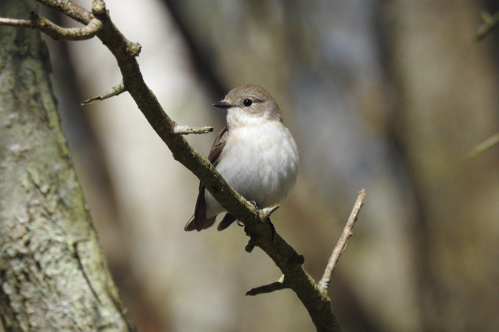

::: {.callout-warning}
## Archived analysis before sample correction
The reproductive results below use the earlier sample and are retained for audit. Use the [corrected analysis and sensitivity checks](revision_20261120.qmd) for the current results, model-ready data, scripts and Supplementary Materials.
:::


```{=html}
<style>#title-block-header { display:none; }</style>
<section class="title-hero">
<video class="title-hero-video" autoplay muted loop playsinline preload="metadata" poster="images/cover-flycatcher.jpg" aria-hidden="true"><source src="media/gotland-background.mp4" type="video/mp4"></video>
<div class="title-hero-text">
<h1>Warmer springs are associated with greater reproductive consistency in the collared flycatcher (<em>Ficedula albicollis</em>): a four-decade study</h1>
<p class="title-subtitle">Spring temperature and reproductive consistency in Gotland's collared flycatchers</p>
<p class="title-authors">Aneta Arct · Santiago Ortega · Rafał Martyka · Lars Gustafsson · Szymon M. Drobniak · Shinichi Nakagawa</p>
<p class="title-notes">Data, analysis workflow and results · Gotland, Sweden</p>
</div></section>
```

## Current revision

[Corrected results, sensitivity analyses, data, code and revised Supplementary Materials](revision_20261120.qmd)

## Study summary

Climate change alters not only mean reproductive performance but also how consistently organisms reproduce from year to year. Using 44 years of individual-based data from collared flycatchers (*Ficedula albicollis*) on Gotland, Sweden, we examined how spring temperature was associated with clutch size, egg-to-fledging success and their variability, and whether these associations differed within and among females. Warmer springs were associated with larger clutches and lower egg-to-fledging success: a 1°C contrast corresponded to approximately 0.10 more eggs and a 3 percentage point reduction in egg-to-fledging success. Within females, warmer-than-average seasons were associated with more consistent clutch sizes (conditional SD approximately 4.6% lower per 1°C). These results show that the same seasonal conditions can be simultaneously associated with greater investment, lower subsequent success and reduced reproductive variability — a combination that remains hidden when only mean performance is monitored. Analyses that jointly model means and variability, and that separate within- from between-individual associations, can reveal dimensions of climate-related reproductive change that average-based approaches miss.

## Study objectives

::: {.overview-background-panel}
```{=html}
<figure class="overview-species-photo"></figure>
```
We examined how early-spring temperature was associated with mean reproductive performance and reproductive consistency, and whether these associations differed within and among females. Temporal changes in reproduction, relative laying date and female age class provide complementary context.
:::

[Source dataset](workflow.qmd#data-origin) · [Model inputs and refit](workflow.qmd#refit-from-the-public-model-data)

## Analyses

### Main analysis

```{=html}
<div class="overview-tiles">
<a class="overview-tile" href="climate_window.html"><h3>S1. Sliding-window analysis</h3></a>
<a class="overview-tile" href="temporal_trends.html"><h3>S2. Calendar-year analyses</h3></a>
<a class="overview-tile" href="clutch_size.html"><h3>S3. Clutch-size models</h3></a>
<a class="overview-tile" href="fledging_success.html"><h3>S4. Egg-to-fledging models</h3></a>
<a class="overview-tile" href="within_between.html"><h3>S5. Within–between temperature models</h3></a>
<a class="overview-tile" href="model_structure.html"><h3>S6. Model structure and diagnostics</h3></a>
<a class="overview-tile" href="full_summaries.html"><h3>S7. Full model summaries</h3></a>
</div>
```

### Appendices

```{=html}
<div class="overview-tiles">
<a class="overview-tile" href="workflow.html"><h3>A1. Data and reproduction workflow</h3></a>
<a class="overview-tile" href="data_preparation.html"><h3>A2. Study sample and predictors</h3></a>
<a class="overview-tile" href="figure_code.html"><h3>A3. Figure code</h3></a>
</div>
```

