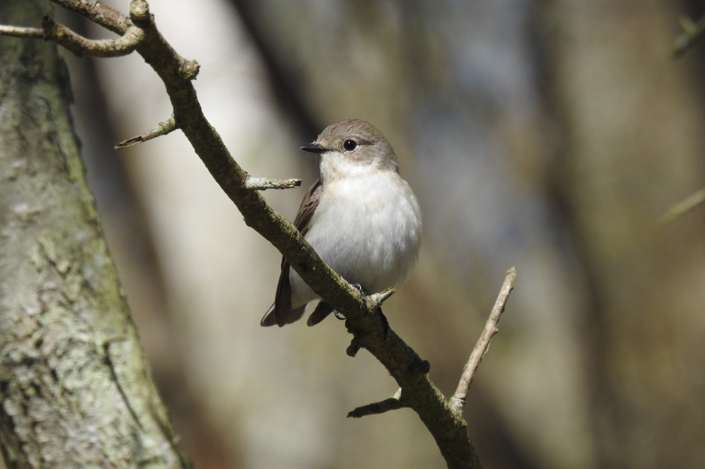

```{=html}
<style>#title-block-header { display:none; }</style>
<section class="title-hero">
<video class="title-hero-video" autoplay muted loop playsinline preload="metadata" poster="images/cover-flycatcher.jpg" aria-hidden="true"><source src="media/gotland-background.mp4" type="video/mp4"></video>
<div class="title-hero-text">
<h1>Opposite climate effects on reproductive investment and success reveal hidden consistency patterns in a migratory bird</h1>
<p class="title-subtitle">Spring temperature and reproductive consistency in Gotland's collared flycatchers</p>
<p class="title-authors">Aneta Arct · Santiago Ortega · Rafał Martyka · Lars Gustafsson · Szymon M. Drobniak · Shinichi Nakagawa</p>
<p class="title-notes">Data, analysis workflow and results · Gotland, Sweden</p>
</div></section>
```

## Study objectives

::: {.overview-background-panel}
```{=html}
<figure class="overview-species-photo"></figure>
```
Using long-term individual-based records of collared flycatchers (*Ficedula albicollis*) breeding in nest boxes on Gotland, Sweden, we examined:

1. Temporal changes in mean spring temperature and its interannual variability.
2. Calendar-year changes in mean reproductive performance and reproductive consistency, assessed using clutch size and egg-to-fledging success.
3. Associations of spring temperature with mean reproductive performance and reproductive consistency.
4. Differences between within-female and among-female temperature associations with both mean reproductive performance and reproductive consistency.
5. Associations of relative laying date and female age class (yearling versus older) with these reproductive traits.
:::

[Data origin and source database](workflow.qmd#data-origin): long-term Gotland breeding monitoring, the source GitHub database and SMHI weather observations.

## Website structure

The analyses are organised as a scientific supplement. Each analysis chapter presents its inputs, methods, code and saved results. Complete model output is collected in S7; data documentation and reproduction instructions are provided in the appendices.

### Main analysis

```{=html}
<div class="overview-tiles">
<a class="overview-tile" href="climate_window.html"><h3>S1. Sliding-window analysis</h3><p>Selection and validation of the pre-laying thermal window.</p></a>
<a class="overview-tile" href="temporal_trends.html"><h3>S2. Calendar-year analyses</h3><p>Temporal changes in reproductive performance and consistency.</p></a>
<a class="overview-tile" href="clutch_size.html"><h3>S3. Clutch-size models</h3><p>Temperature associations with reproductive investment.</p></a>
<a class="overview-tile" href="fledging_success.html"><h3>S4. Egg-to-fledging models</h3><p>Temperature associations with reproductive success.</p></a>
<a class="overview-tile" href="within_between.html"><h3>S5. Within–between temperature models</h3><p>Within-female and among-female temperature associations.</p></a>
<a class="overview-tile" href="model_structure.html"><h3>S6. Model structure and diagnostics</h3><p>Distributional assumptions, convergence and simulation checks.</p></a>
<a class="overview-tile" href="full_summaries.html"><h3>S7. Full model summaries</h3><p>Complete R output for the six reproductive models.</p></a>
</div>
```

### Appendices

```{=html}
<div class="overview-tiles">
<a class="overview-tile" href="workflow.html"><h3>A1. Data and reproduction workflow</h3><p>Public inputs, sample audits and model reproduction.</p></a>
<a class="overview-tile" href="data_preparation.html"><h3>A2. Study sample and predictors</h3><p>Breeding records, variable definitions and centring.</p></a>
<a class="overview-tile" href="figure_code.html"><h3>A3. Figure code</h3><p>Prediction tables and scripts for the reported figures.</p></a>
</div>
```

