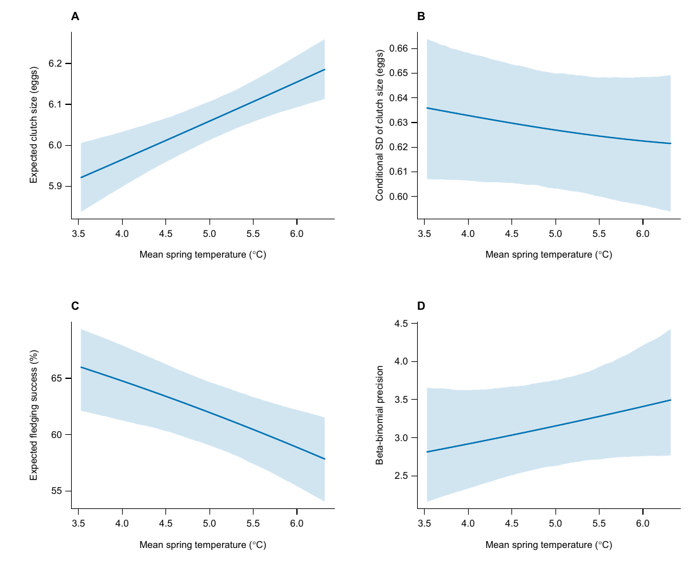
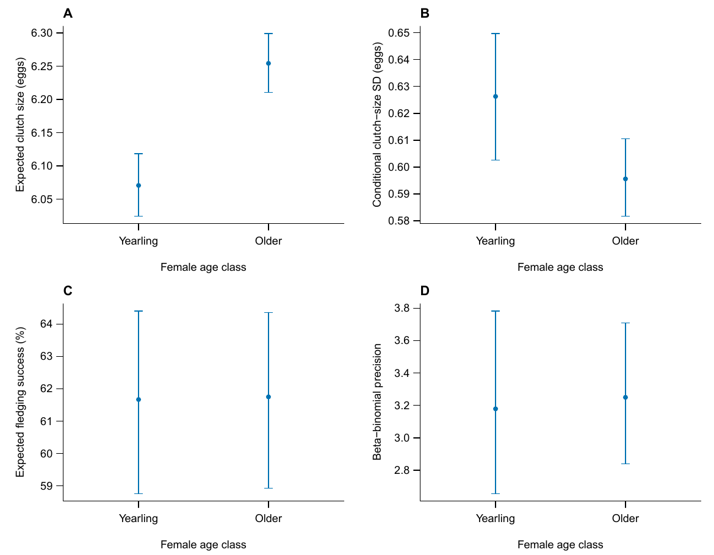
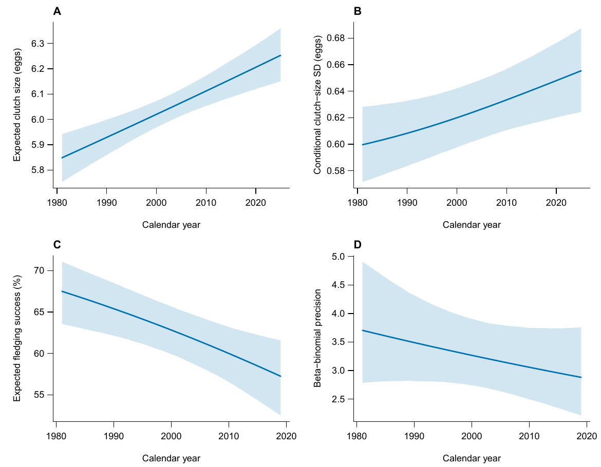
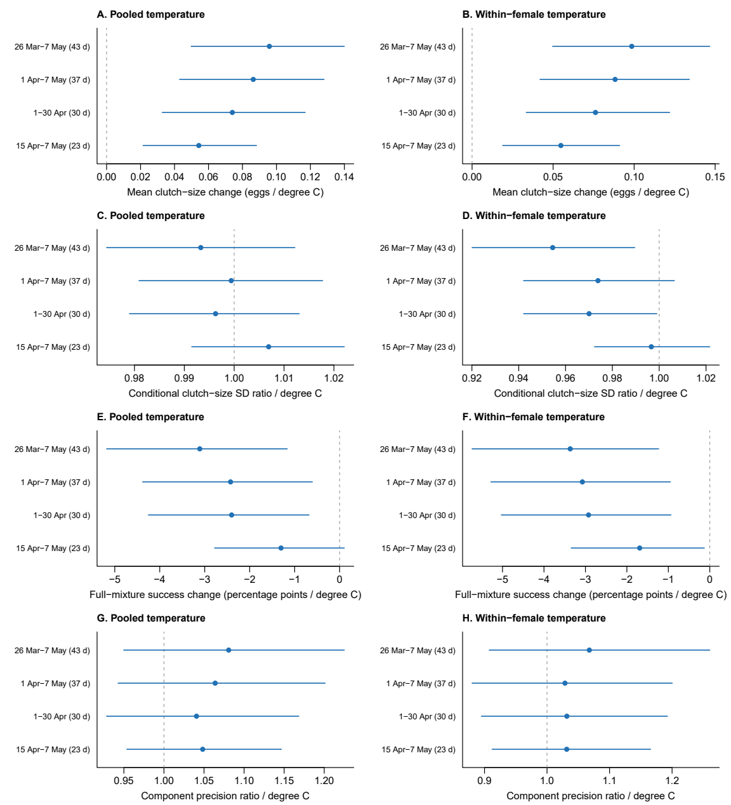

::: {.callout-important}
## Analysis and sensitivity checks
Entire recorded histories of experimental females and all records in ambiguous duplicate female-season groups were excluded. The current samples contain **12,344 clutch records from 8,675 females** and **9,785 fledging records from 7,128 females**.
:::

## Downloads and reproduction

- [Revised Supplementary Materials](revision_20261120/Supplement_20261120.pdf)
- [Current model-ready data, results and analysis scripts](revision_20261120/Supplementary_Data_20261119.zip)
- [Package README and reproduction instructions](revision_20261120/analysis/README.txt)
- [Runner](revision_20261120/analysis/run_revision_from_public_data.R)

The package contains anonymous model-ready records, numerical exports, scripts and checksums. It supports fitting from the supplied model-ready records; it is not a complete raw-field-data cleaning workflow. Fitting steps were run in the separate revision checkout. The assembled public wrapper has been syntax-checked, but has not yet been rerun end-to-end after extraction into a further fresh checkout. The original field-data source and access information remain documented in the [archived workflow](workflow.qmd#data-origin).

## Study title and abstract

**Warmer springs are associated with greater reproductive consistency in the collared flycatcher (Ficedula albicollis): a four-decade study**

Climate change is reshaping when and how well organisms reproduce, but changes in average performance may tell only part of the story. How consistently organisms reproduce may also matter. Using 44 years of individual-based data from collared flycatchers (*Ficedula albicollis*) on Gotland, Sweden, we examined associations between spring temperature, reproductive performance and reproductive consistency. Warmer springs were associated with larger clutches but lower egg-to-fledging success, suggesting that greater reproductive investment need not translate into greater success. Within females, warmer-than-average seasons were also associated with more consistent clutch sizes, although this association depended on the spring period considered. These findings show that environmental associations with reproductive investment, subsequent success and consistency can differ within the same population. Examining both average performance and reproductive consistency, while distinguishing associations within and among individuals, offers a fuller understanding of reproductive responses to environmental change.

## Questions and interpretation

We examined how early-spring temperature was associated with mean reproductive performance and reproductive consistency, and whether these associations differed within and among females. Temporal changes in reproduction, relative laying date and female age class provide complementary context.

A location–scale framework examines mean reproductive performance and variation among breeding attempts together. Trait-specific interpretations are introduced with the study questions and detailed in Methods. Warmer conditions could favour egg production if feeding conditions improve before laying. No directional prediction is specified for subsequent success, reproductive variability or differences between within- and between-female temperature slopes.

We define **fledging success** as the proportion of eggs laid that produce fledglings. After this definition, the shorter term is used in the main text and figures. The abstract retains the full term “egg-to-fledging success”. Greater clutch-size consistency means lower conditional clutch-size variation; fledging component precision is distinguished from overall variation in fledging success.

## Environmental context — SM S1.5

Mean spring temperature increased by 0.0439°C per year (95% CI 0.0248–0.0630). There was no clear evidence of a change in residual interannual variability (log-SD slope −0.0111 per year, 95% CI −0.0277 to 0.0055). Temperature variability is descriptive environmental context, not a separate study aim or a tested mechanism linking environmental variability to reproduction. Complete environmental methods and checks remain in SM S1.5; a brief result remains in Results 3.1.

## Main temperature associations

For a +1°C contrast, the expected clutch-size change in the model with spring temperature is approximately +0.096 eggs. The primary-window within-female conditional clutch-SD ratio is 0.954 (95% CI 0.918–0.990), corresponding to 0.624 to 0.596 eggs at the reference conditions. This is conditional variation among attempts, not female-specific repeatability or demonstrated plasticity. Fledging success changes from 61.67% to 58.56% (−3.11 percentage points, 95% CI −5.14 to −1.13).

## Fixed-window sensitivity — SM S1.13

The primary window remains **26 March–7 May**. Alternative fixed windows are **1 April–7 May**, **1–30 April**, and **15 April–7 May**, using identical trait-specific records. The positive association with mean clutch size persists in all windows. Fledging-success estimates remain negative; within-female intervals exclude zero in all windows, whereas intervals from the model with spring temperature and the between-female component include zero in the shortest/latest window. The within-female clutch-SD association is supported for the primary and April-only windows, but is uncertain for the other two. Thus, the other results depend more on exposure definition. See Methods 2.6, Results 3.3 and Discussion 4.2; SM Tables S16–S18 and Fig. S6.

## Exact-age sensitivity — SM S1.11

The main models use yearlings and older females. The full clutch sample contains 3,723 yearling and 8,621 older-female attempts; the known or consistently reconstructable exact-age subset contains 3,704 and 3,573. Fledging counts are 2,986 and 6,799 in the full sample, and 2,977 and 2,929 in the exact-age subset. Restriction disproportionately removes older-female records and changes age composition. Exact age combines recorded hatch years with consistent yearling and integer-age histories under the explicit audit assumptions in SM S1.11. Counts refer to breeding attempts; females can contribute to both age classes in different seasons.

Restricting the analysis to females of known or consistently reconstructable exact age substantially reduces and changes the sample: **7,277 clutch records from 4,957 females** and **5,906 fledging records from 4,186 females**. Within these identical subsets, replacing age classes with linear or quadratic exact age changes the estimated temperature associations little. However, the clutch-size variability association is already uncertain in the restricted sample with categorical age. Thus, the analysis provides limited additional information about age adjustment and cannot establish robustness of the full-sample result. It estimates conditional temperature associations among age-known females, not individual ageing trajectories. These analyses remain supplementary (Tables S10–S13); detailed exact-age results are not presented as a main-text finding.

## Temporal models — supplementary context, SM S1.10

Expected clutch size increases from 5.85 to 6.25 eggs over 1981–2025 (+0.405, 95% CI 0.243–0.576). Conditional clutch-SD increases (ratio 1.093, 95% CI 1.021–1.169). Expected fledging success declines from 67.5% to 57.2% over 1981–2019 (−10.3 percentage points, 95% CI −16.4 to −4.0); component-precision change is uncertain. These models retain age class and relative laying date. They provide temporal context and do not identify a causal warming effect. Full results: Tables S8–S9 and Fig. S5; brief interpretation: Discussion 4.3, final paragraph.

Temperature-adjusted calendar-year contrasts are also provided in SM Table S9. They are conditional temporal contrasts, not a causal decomposition of warming. Temporal trends are omitted from the current abstract.

## Temperature in the additional-zero component — SM S1.12

Adding temperature to the additional-zero equation improves AIC by 4.67. The fledging success contrast is −5.41 percentage points per +1°C (95% CI −8.12 to −2.79). For a reference six-egg clutch, brood-failure probability increases from 19.52% to 23.14%. The association remains negative, but its magnitude depends on this specification. Component precision is distinct from overall variation in fledging success; additional zeros are not assigned a separate biological failure mechanism. See Tables S14–S15.

## Additional robustness checks — SM S1.14

Both previously outstanding checks have now been attempted on the current samples. Five specifications were numerically validated. The repeated-female samples contain **6,169 clutch records from 2,500 females** and **4,564 fledging records from 1,907 females**, preserving full-sample centring and thermal decomposition.

The validated clutch model with spring temperature retains a positive mean association (+0.086 eggs/°C, 95% CI 0.036–0.134); its SD ratio is 0.971 (0.941–1.001). Fledging-success associations remain negative: model with model with spring temperature −3.99 percentage points/°C (−6.15 to −1.95), within female −4.26 (−6.60 to −2.04), and between females −3.48 (−6.02 to −1.07). Component-precision ratios remain uncertain.

The **repeated-female clutch within–between model did not yield a numerically validated fit** after multiple optimiser and gradient checks. A candidate-region audit found an extremely large gradient and instability of the evaluated objective. Affected or stalled trials were terminated. No estimate from that specification is reported, and the validated result from the model with spring temperature does not establish robustness of the primary within-female clutch-SD association. This check remains numerically inconclusive.

Adding an independent year random intercept to clutch scale on the full current sample, in both temperature formulations, gives SD about **7 × 10⁻⁷**, negligible likelihood/coefficient changes, and ΔAIC about +2. Initial singular-convergence warnings occurred near zero variance; BFGS refinements reproduced the primary models with convergence code zero and positive-definite Hessians. The simpler primary structures are retained. The fledging model already has a year random intercept in precision.

See SM S1.14, Tables S19–S21, and the [full numerical and failed-attempt audit](revision_20261120/analysis/remaining_robustness_20261120/README.txt). These checks do not remove exposure-window or sample-composition limitations.

## Verification and limits

The current main models and retained sensitivity fits have numerical checks and independent optimisation diagnostics. Failed attempts are documented and excluded from inference. The assembled public wrapper has not been rerun end-to-end after extraction into a further fresh checkout. Environmental temperature analyses use independent annual weather records and are unchanged by female exclusions.

## Revised figures

Mean spring temperature and female mean spring temperature are displayed in °C on their original scales. Within-female temperature is displayed as the difference from the female’s observed mean. Only the horizontal display coordinates have changed; model predictions and confidence intervals are unchanged.

### Main temperature associations

[Download figure PDF](revision_20261120/Fig_temperature_main_20261119.pdf)

### Complete temperature predictions

[Download figure PDF](revision_20261120/Fig_temperature_full_20261119.pdf)

### Within and between females — clutch size

[Download figure PDF](revision_20261120/Fig_within_between_clutch_20261119.pdf)

### Within and between females — fledging success

[Download figure PDF](revision_20261120/Fig_within_between_fledging_20261119.pdf)

### Laying-date predictions

[Download figure PDF](revision_20261120/Fig_laying_date_20261119.pdf)

### Age-class predictions

[Download figure PDF](revision_20261120/Fig_age_class_20261119.pdf)

### Temporal predictions without temperature

[Download figure PDF](revision_20261120/Fig_temporal_without_temperature_20261119.pdf)

### Fixed-window sensitivity

[Download figure PDF](revision_20261120/Fig_window_sensitivity_20261119.pdf)

## Numerical exports and scripts

All files below also appear in the downloadable archive. Model-ready records have anonymous identifiers. Calendar-year decomposition is a response-only working check and is not part of this public supplement.

### `data_derived/analysis_clean_20261119`

- [clutch_model_data.csv](revision_20261120/analysis/data_derived/analysis_clean_20261119/clutch_model_data.csv)
- [curation_audit.csv](revision_20261120/analysis/data_derived/analysis_clean_20261119/curation_audit.csv)
- [expected_annual.csv](revision_20261120/analysis/data_derived/analysis_clean_20261119/expected_annual.csv)
- [fledging_model_data.csv](revision_20261120/analysis/data_derived/analysis_clean_20261119/fledging_model_data.csv)

### `tables/within_between_20261026_clean_20261119`

- [clutch_baseline_summary.txt](revision_20261120/analysis/tables/within_between_20261026_clean_20261119/clutch_baseline_summary.txt)
- [clutch_within_between_summary.txt](revision_20261120/analysis/tables/within_between_20261026_clean_20261119/clutch_within_between_summary.txt)
- [conditional_simulation_checks.csv](revision_20261120/analysis/tables/within_between_20261026_clean_20261119/conditional_simulation_checks.csv)
- [export_session_info.txt](revision_20261120/analysis/tables/within_between_20261026_clean_20261119/export_session_info.txt)
- [fixed_design_vif.csv](revision_20261120/analysis/tables/within_between_20261026_clean_20261119/fixed_design_vif.csv)
- [fixed_effects.csv](revision_20261120/analysis/tables/within_between_20261026_clean_20261119/fixed_effects.csv)
- [fledging_baseline_summary.txt](revision_20261120/analysis/tables/within_between_20261026_clean_20261119/fledging_baseline_summary.txt)
- [fledging_within_between_summary.txt](revision_20261120/analysis/tables/within_between_20261026_clean_20261119/fledging_within_between_summary.txt)
- [model_comparison.csv](revision_20261120/analysis/tables/within_between_20261026_clean_20261119/model_comparison.csv)
- [optimizer_comparison.csv](revision_20261120/analysis/tables/within_between_20261026_clean_20261119/optimizer_comparison.csv)
- [prediction_curves.csv](revision_20261120/analysis/tables/within_between_20261026_clean_20261119/prediction_curves.csv)
- [random_effect_SD.csv](revision_20261120/analysis/tables/within_between_20261026_clean_20261119/random_effect_SD.csv)
- [reference_effects_per_degree.csv](revision_20261120/analysis/tables/within_between_20261026_clean_20261119/reference_effects_per_degree.csv)
- [sample_metadata.csv](revision_20261120/analysis/tables/within_between_20261026_clean_20261119/sample_metadata.csv)
- [session_info.txt](revision_20261120/analysis/tables/within_between_20261026_clean_20261119/session_info.txt)
- [within_between_contrasts.csv](revision_20261120/analysis/tables/within_between_20261026_clean_20261119/within_between_contrasts.csv)

### `tables/temporal_clean_20261119`

- [clutch_year_mean.csv](revision_20261120/analysis/tables/temporal_clean_20261119/clutch_year_mean.csv)
- [clutch_year_sd.csv](revision_20261120/analysis/tables/temporal_clean_20261119/clutch_year_sd.csv)
- [fledging_year_phi.csv](revision_20261120/analysis/tables/temporal_clean_20261119/fledging_year_phi.csv)
- [fledging_year_success.csv](revision_20261120/analysis/tables/temporal_clean_20261119/fledging_year_success.csv)
- [random_SD.csv](revision_20261120/analysis/tables/temporal_clean_20261119/random_SD.csv)
- [README.txt](revision_20261120/analysis/tables/temporal_clean_20261119/README.txt)
- [temporal_simulation_checks.csv](revision_20261120/analysis/tables/temporal_clean_20261119/temporal_simulation_checks.csv)

### `tables/joint_year_clean_20261119`

- [contrasts.csv](revision_20261120/analysis/tables/joint_year_clean_20261119/contrasts.csv)
- [curves.csv](revision_20261120/analysis/tables/joint_year_clean_20261119/curves.csv)
- [session_info.txt](revision_20261120/analysis/tables/joint_year_clean_20261119/session_info.txt)
- [year_coefficients.csv](revision_20261120/analysis/tables/joint_year_clean_20261119/year_coefficients.csv)

### `tables/curation_checks_20261119`

- [baseline_random_SD.csv](revision_20261120/analysis/tables/curation_checks_20261119/baseline_random_SD.csv)
- [baseline_vif.csv](revision_20261120/analysis/tables/curation_checks_20261119/baseline_vif.csv)
- [clutch_SD_contrasts.csv](revision_20261120/analysis/tables/curation_checks_20261119/clutch_SD_contrasts.csv)
- [extra_zero_fixed.csv](revision_20261120/analysis/tables/curation_checks_20261119/extra_zero_fixed.csv)
- [extra_zero_model_comparison.csv](revision_20261120/analysis/tables/curation_checks_20261119/extra_zero_model_comparison.csv)
- [extra_zero_validated_comparison.csv](revision_20261120/analysis/tables/curation_checks_20261119/extra_zero_validated_comparison.csv)
- [extra_zero_validated_fixed.csv](revision_20261120/analysis/tables/curation_checks_20261119/extra_zero_validated_fixed.csv)
- [full_mixture_contrasts.csv](revision_20261120/analysis/tables/curation_checks_20261119/full_mixture_contrasts.csv)
- [new_group_simulations.csv](revision_20261120/analysis/tables/curation_checks_20261119/new_group_simulations.csv)
- [poisson_diagnostics.csv](revision_20261120/analysis/tables/curation_checks_20261119/poisson_diagnostics.csv)
- [poisson_fixed.csv](revision_20261120/analysis/tables/curation_checks_20261119/poisson_fixed.csv)
- [sample_summary.csv](revision_20261120/analysis/tables/curation_checks_20261119/sample_summary.csv)
- [session_info.txt](revision_20261120/analysis/tables/curation_checks_20261119/session_info.txt)

### `tables/reproduced`

- [baseline_predictions/contrasts.csv](revision_20261120/analysis/tables/reproduced/baseline_predictions/contrasts.csv)
- [baseline_predictions/curves.csv](revision_20261120/analysis/tables/reproduced/baseline_predictions/curves.csv)
- [baseline_predictions/session_info.txt](revision_20261120/analysis/tables/reproduced/baseline_predictions/session_info.txt)
- [baseline_simulation_checks.csv](revision_20261120/analysis/tables/reproduced/baseline_simulation_checks.csv)

### `models/temporal_clean_20261119`

- [clutch_diagnostics.csv](revision_20261120/analysis/models/temporal_clean_20261119/clutch_diagnostics.csv)
- [clutch_with_temperature_summary.txt](revision_20261120/analysis/models/temporal_clean_20261119/clutch_with_temperature_summary.txt)
- [clutch_without_temperature_summary.txt](revision_20261120/analysis/models/temporal_clean_20261119/clutch_without_temperature_summary.txt)
- [COMPLETE.txt](revision_20261120/analysis/models/temporal_clean_20261119/COMPLETE.txt)
- [fixed_effects.csv](revision_20261120/analysis/models/temporal_clean_20261119/fixed_effects.csv)
- [fledging_diagnostics.csv](revision_20261120/analysis/models/temporal_clean_20261119/fledging_diagnostics.csv)
- [fledging_with_temperature_summary.txt](revision_20261120/analysis/models/temporal_clean_20261119/fledging_with_temperature_summary.txt)
- [fledging_without_temperature_summary.txt](revision_20261120/analysis/models/temporal_clean_20261119/fledging_without_temperature_summary.txt)
- [observed_annual.csv](revision_20261120/analysis/models/temporal_clean_20261119/observed_annual.csv)
- [optimizer_comparison.csv](revision_20261120/analysis/models/temporal_clean_20261119/optimizer_comparison.csv)
- [original_model_hashes.csv](revision_20261120/analysis/models/temporal_clean_20261119/original_model_hashes.csv)
- [reference_curves.csv](revision_20261120/analysis/models/temporal_clean_20261119/reference_curves.csv)
- [session_info.txt](revision_20261120/analysis/models/temporal_clean_20261119/session_info.txt)
- [temporal_changes.csv](revision_20261120/analysis/models/temporal_clean_20261119/temporal_changes.csv)

### `age_sensitivity_20261119`

- [age_counts.csv](revision_20261120/analysis/age_sensitivity_20261119/age_counts.csv)
- [clutch_age_class_summary.txt](revision_20261120/analysis/age_sensitivity_20261119/clutch_age_class_summary.txt)
- [clutch_exact_age_linear_summary.txt](revision_20261120/analysis/age_sensitivity_20261119/clutch_exact_age_linear_summary.txt)
- [clutch_exact_age_quadratic_summary.txt](revision_20261120/analysis/age_sensitivity_20261119/clutch_exact_age_quadratic_summary.txt)
- [clutch_known_age_model_data.csv](revision_20261120/analysis/age_sensitivity_20261119/clutch_known_age_model_data.csv)
- [diagnostics.csv](revision_20261120/analysis/age_sensitivity_20261119/diagnostics.csv)
- [fixed_effects.csv](revision_20261120/analysis/age_sensitivity_20261119/fixed_effects.csv)
- [fledging_age_class_summary.txt](revision_20261120/analysis/age_sensitivity_20261119/fledging_age_class_summary.txt)
- [fledging_exact_age_linear_summary.txt](revision_20261120/analysis/age_sensitivity_20261119/fledging_exact_age_linear_summary.txt)
- [fledging_exact_age_quadratic_summary.txt](revision_20261120/analysis/age_sensitivity_20261119/fledging_exact_age_quadratic_summary.txt)
- [fledging_known_age_model_data.csv](revision_20261120/analysis/age_sensitivity_20261119/fledging_known_age_model_data.csv)
- [reference_contrasts.csv](revision_20261120/analysis/age_sensitivity_20261119/reference_contrasts.csv)
- [sample_counts.csv](revision_20261120/analysis/age_sensitivity_20261119/sample_counts.csv)
- [session_info.txt](revision_20261120/analysis/age_sensitivity_20261119/session_info.txt)
- [validated_diagnostics.csv](revision_20261120/analysis/age_sensitivity_20261119/validated_diagnostics.csv)
- [validated_fixed_effects.csv](revision_20261120/analysis/age_sensitivity_20261119/validated_fixed_effects.csv)

### `window_sensitivity_20261119`

- [annual_exposures.csv](revision_20261120/analysis/window_sensitivity_20261119/annual_exposures.csv)
- [diagnostics.csv](revision_20261120/analysis/window_sensitivity_20261119/diagnostics.csv)
- [failed_optimizer_audit.csv](revision_20261120/analysis/window_sensitivity_20261119/failed_optimizer_audit.csv)
- [fixed_effects.csv](revision_20261120/analysis/window_sensitivity_20261119/fixed_effects.csv)
- [reference_contrasts.csv](revision_20261120/analysis/window_sensitivity_20261119/reference_contrasts.csv)
- [session_info.txt](revision_20261120/analysis/window_sensitivity_20261119/session_info.txt)

### `R/revision_20261119`

- [export_sensitivity_contrasts.R](revision_20261120/analysis/R/revision_20261119/export_sensitivity_contrasts.R)
- [fit_exact_age_public.R](revision_20261120/analysis/R/revision_20261119/fit_exact_age_public.R)
- [fit_window_sensitivity.R](revision_20261120/analysis/R/revision_20261119/fit_window_sensitivity.R)
- [plot_revised_results.R](revision_20261120/analysis/R/revision_20261119/plot_revised_results.R)
- [plot_window_sensitivity.R](revision_20261120/analysis/R/revision_20261119/plot_window_sensitivity.R)
- [refine_extra_zero.R](revision_20261120/analysis/R/revision_20261119/refine_extra_zero.R)
- [revision_diagnostics.R](revision_20261120/analysis/R/revision_20261119/revision_diagnostics.R)
- [validate_age.R](revision_20261120/analysis/R/revision_20261119/validate_age.R)

## Additional robustness exports

- [baseline_restart.log](revision_20261120/analysis/remaining_robustness_20261120/baseline_restart.log)
- [objective_audit.log](revision_20261120/analysis/remaining_robustness_20261120/objective_audit.log)
- [objective_current_point_audit.log](revision_20261120/analysis/remaining_robustness_20261120/objective_current_point_audit.log)
- [README.txt](revision_20261120/analysis/remaining_robustness_20261120/README.txt)
- [repeated_clutch_bounded.log](revision_20261120/analysis/remaining_robustness_20261120/repeated_clutch_bounded.log)
- [repeated_clutch_numeric.log](revision_20261120/analysis/remaining_robustness_20261120/repeated_clutch_numeric.log)
- [repeated_females_clutch_baseline/comparisons.csv](revision_20261120/analysis/remaining_robustness_20261120/repeated_females_clutch_baseline/comparisons.csv)
- [repeated_females_clutch_baseline/diagrows.csv](revision_20261120/analysis/remaining_robustness_20261120/repeated_females_clutch_baseline/diagrows.csv)
- [repeated_females_clutch_baseline/effects.csv](revision_20261120/analysis/remaining_robustness_20261120/repeated_females_clutch_baseline/effects.csv)
- [repeated_females_clutch_baseline/fixed.csv](revision_20261120/analysis/remaining_robustness_20261120/repeated_females_clutch_baseline/fixed.csv)
- [repeated_females_clutch_baseline/independent_restart_diagnostics.csv](revision_20261120/analysis/remaining_robustness_20261120/repeated_females_clutch_baseline/independent_restart_diagnostics.csv)
- [repeated_females_clutch_baseline/random.csv](revision_20261120/analysis/remaining_robustness_20261120/repeated_females_clutch_baseline/random.csv)
- [repeated_females_clutch_baseline/repeated_females_clutch_baseline_summary.txt](revision_20261120/analysis/remaining_robustness_20261120/repeated_females_clutch_baseline/repeated_females_clutch_baseline_summary.txt)
- [repeated_females_clutch_baseline/samples.csv](revision_20261120/analysis/remaining_robustness_20261120/repeated_females_clutch_baseline/samples.csv)
- [repeated_females_clutch_baseline/session_info.txt](revision_20261120/analysis/remaining_robustness_20261120/repeated_females_clutch_baseline/session_info.txt)
- [repeated_females_clutch_baseline.initial_BFGS_audit.log](revision_20261120/analysis/remaining_robustness_20261120/repeated_females_clutch_baseline.initial_BFGS_audit.log)
- [repeated_females_clutch_baseline.log](revision_20261120/analysis/remaining_robustness_20261120/repeated_females_clutch_baseline.log)
- [repeated_females_clutch_baseline.scaling_audit.log](revision_20261120/analysis/remaining_robustness_20261120/repeated_females_clutch_baseline.scaling_audit.log)
- [repeated_females_clutch_within_between.cold_mode_audit.log](revision_20261120/analysis/remaining_robustness_20261120/repeated_females_clutch_within_between.cold_mode_audit.log)
- [repeated_females_clutch_within_between.initial_BFGS_audit.log](revision_20261120/analysis/remaining_robustness_20261120/repeated_females_clutch_within_between.initial_BFGS_audit.log)
- [repeated_females_clutch_within_between.log](revision_20261120/analysis/remaining_robustness_20261120/repeated_females_clutch_within_between.log)
- [Within-female clutch model: optimiser audit](revision_20261120/analysis/remaining_robustness_20261120/repeated_females_clutch_within_between.pooled_BFGS_audit.log)
- [repeated_females_clutch_within_between.reference_start_audit.log](revision_20261120/analysis/remaining_robustness_20261120/repeated_females_clutch_within_between.reference_start_audit.log)
- [repeated_females_clutch_within_between.scaling_audit.log](revision_20261120/analysis/remaining_robustness_20261120/repeated_females_clutch_within_between.scaling_audit.log)
- [repeated_females_fledging_baseline/comparisons.csv](revision_20261120/analysis/remaining_robustness_20261120/repeated_females_fledging_baseline/comparisons.csv)
- [repeated_females_fledging_baseline/diagrows.csv](revision_20261120/analysis/remaining_robustness_20261120/repeated_females_fledging_baseline/diagrows.csv)
- [repeated_females_fledging_baseline/effects.csv](revision_20261120/analysis/remaining_robustness_20261120/repeated_females_fledging_baseline/effects.csv)
- [repeated_females_fledging_baseline/fixed.csv](revision_20261120/analysis/remaining_robustness_20261120/repeated_females_fledging_baseline/fixed.csv)
- [repeated_females_fledging_baseline/random.csv](revision_20261120/analysis/remaining_robustness_20261120/repeated_females_fledging_baseline/random.csv)
- [repeated_females_fledging_baseline/repeated_females_fledging_baseline_summary.txt](revision_20261120/analysis/remaining_robustness_20261120/repeated_females_fledging_baseline/repeated_females_fledging_baseline_summary.txt)
- [repeated_females_fledging_baseline/samples.csv](revision_20261120/analysis/remaining_robustness_20261120/repeated_females_fledging_baseline/samples.csv)
- [repeated_females_fledging_baseline/session_info.txt](revision_20261120/analysis/remaining_robustness_20261120/repeated_females_fledging_baseline/session_info.txt)
- [repeated_females_fledging_baseline.log](revision_20261120/analysis/remaining_robustness_20261120/repeated_females_fledging_baseline.log)
- [repeated_females_fledging_within_between/comparisons.csv](revision_20261120/analysis/remaining_robustness_20261120/repeated_females_fledging_within_between/comparisons.csv)
- [repeated_females_fledging_within_between/diagrows.csv](revision_20261120/analysis/remaining_robustness_20261120/repeated_females_fledging_within_between/diagrows.csv)
- [repeated_females_fledging_within_between/effects.csv](revision_20261120/analysis/remaining_robustness_20261120/repeated_females_fledging_within_between/effects.csv)
- [repeated_females_fledging_within_between/fixed.csv](revision_20261120/analysis/remaining_robustness_20261120/repeated_females_fledging_within_between/fixed.csv)
- [repeated_females_fledging_within_between/random.csv](revision_20261120/analysis/remaining_robustness_20261120/repeated_females_fledging_within_between/random.csv)
- [repeated_females_fledging_within_between/repeated_females_fledging_within_between_summary.txt](revision_20261120/analysis/remaining_robustness_20261120/repeated_females_fledging_within_between/repeated_females_fledging_within_between_summary.txt)
- [repeated_females_fledging_within_between/samples.csv](revision_20261120/analysis/remaining_robustness_20261120/repeated_females_fledging_within_between/samples.csv)
- [repeated_females_fledging_within_between/session_info.txt](revision_20261120/analysis/remaining_robustness_20261120/repeated_females_fledging_within_between/session_info.txt)
- [repeated_females_fledging_within_between.log](revision_20261120/analysis/remaining_robustness_20261120/repeated_females_fledging_within_between.log)
- [scale_boundary_audit.csv](revision_20261120/analysis/remaining_robustness_20261120/scale_boundary_audit.csv)
- [scale_year_clutch_baseline/comparisons.csv](revision_20261120/analysis/remaining_robustness_20261120/scale_year_clutch_baseline/comparisons.csv)
- [scale_year_clutch_baseline/diagrows.csv](revision_20261120/analysis/remaining_robustness_20261120/scale_year_clutch_baseline/diagrows.csv)
- [scale_year_clutch_baseline/effects.csv](revision_20261120/analysis/remaining_robustness_20261120/scale_year_clutch_baseline/effects.csv)
- [scale_year_clutch_baseline/fixed.csv](revision_20261120/analysis/remaining_robustness_20261120/scale_year_clutch_baseline/fixed.csv)
- [scale_year_clutch_baseline/random.csv](revision_20261120/analysis/remaining_robustness_20261120/scale_year_clutch_baseline/random.csv)
- [scale_year_clutch_baseline/samples.csv](revision_20261120/analysis/remaining_robustness_20261120/scale_year_clutch_baseline/samples.csv)
- [scale_year_clutch_baseline/scale_year_clutch_baseline_summary.txt](revision_20261120/analysis/remaining_robustness_20261120/scale_year_clutch_baseline/scale_year_clutch_baseline_summary.txt)
- [scale_year_clutch_baseline/session_info.txt](revision_20261120/analysis/remaining_robustness_20261120/scale_year_clutch_baseline/session_info.txt)
- [scale_year_clutch_baseline.initial_BFGS_audit.log](revision_20261120/analysis/remaining_robustness_20261120/scale_year_clutch_baseline.initial_BFGS_audit.log)
- [scale_year_clutch_baseline.log](revision_20261120/analysis/remaining_robustness_20261120/scale_year_clutch_baseline.log)
- [scale_year_clutch_baseline.scaling_audit.log](revision_20261120/analysis/remaining_robustness_20261120/scale_year_clutch_baseline.scaling_audit.log)
- [scale_year_clutch_within_between/comparisons.csv](revision_20261120/analysis/remaining_robustness_20261120/scale_year_clutch_within_between/comparisons.csv)
- [scale_year_clutch_within_between/diagrows.csv](revision_20261120/analysis/remaining_robustness_20261120/scale_year_clutch_within_between/diagrows.csv)
- [scale_year_clutch_within_between/effects.csv](revision_20261120/analysis/remaining_robustness_20261120/scale_year_clutch_within_between/effects.csv)
- [scale_year_clutch_within_between/fixed.csv](revision_20261120/analysis/remaining_robustness_20261120/scale_year_clutch_within_between/fixed.csv)
- [scale_year_clutch_within_between/random.csv](revision_20261120/analysis/remaining_robustness_20261120/scale_year_clutch_within_between/random.csv)
- [scale_year_clutch_within_between/samples.csv](revision_20261120/analysis/remaining_robustness_20261120/scale_year_clutch_within_between/samples.csv)
- [scale_year_clutch_within_between/scale_year_clutch_within_between_summary.txt](revision_20261120/analysis/remaining_robustness_20261120/scale_year_clutch_within_between/scale_year_clutch_within_between_summary.txt)
- [scale_year_clutch_within_between/session_info.txt](revision_20261120/analysis/remaining_robustness_20261120/scale_year_clutch_within_between/session_info.txt)
- [scale_year_clutch_within_between.initial_BFGS_audit.log](revision_20261120/analysis/remaining_robustness_20261120/scale_year_clutch_within_between.initial_BFGS_audit.log)
- [scale_year_clutch_within_between.log](revision_20261120/analysis/remaining_robustness_20261120/scale_year_clutch_within_between.log)
- [scale_year_clutch_within_between.scaling_audit.log](revision_20261120/analysis/remaining_robustness_20261120/scale_year_clutch_within_between.scaling_audit.log)
