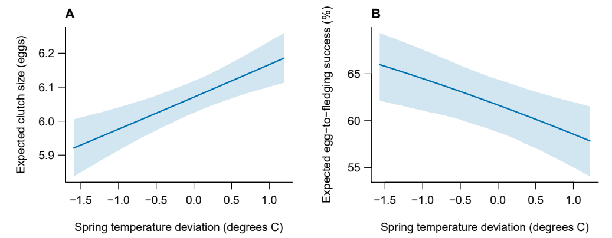
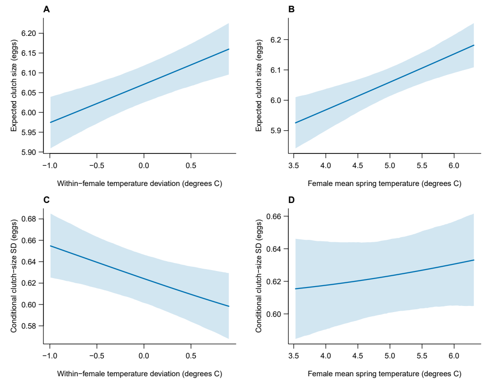
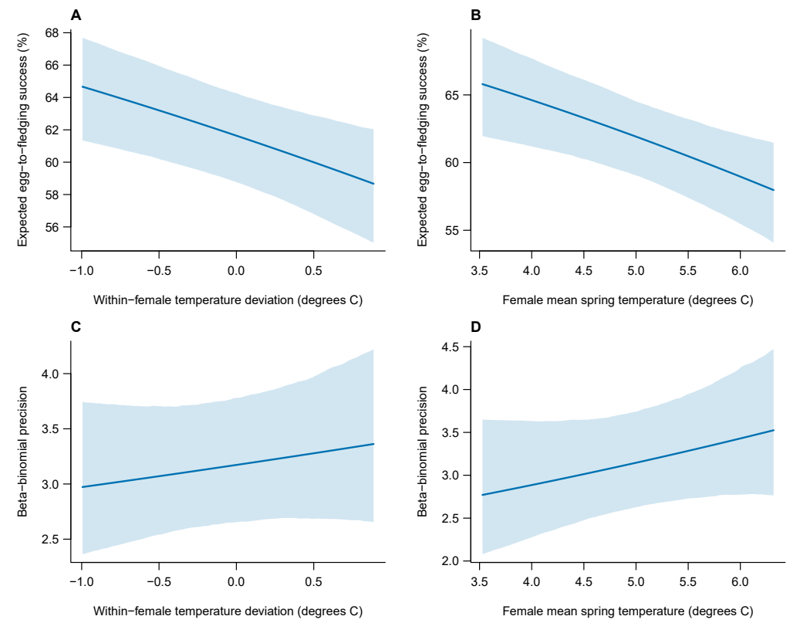
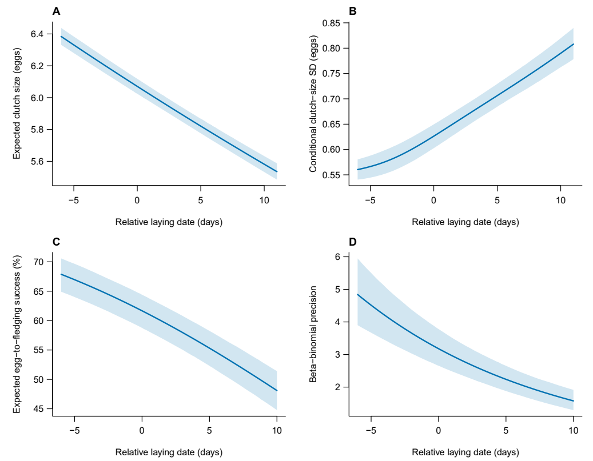

::: {.callout-important}
## Current corrected analysis — 20 November 2026
The reproductive results on this page replace the earlier release. Entire recorded histories of experimental females and all records in ambiguous duplicate female-season groups were excluded. The corrected samples contain **12,344 clutch records from 8,675 females** and **9,785 fledging records from 7,128 females**. Earlier analysis pages are retained as clearly marked archives.
:::

## Downloads and reproduction

- [Revised Supplementary Materials](revision_20261120/Supplement_20261120.pdf)
- [Corrected model-ready data, results and analysis scripts](revision_20261120/Supplementary_Data_20261119.zip)
- [Package README and reproduction instructions](revision_20261120/analysis/README.txt)
- [Runner](revision_20261120/analysis/run_revision_from_public_data.R)

The package contains anonymous model-ready records, numerical exports, scripts and checksums. It supports fitting from the supplied model-ready records; it is not a complete raw-field-data cleaning workflow. Fitting steps were run in the separate revision checkout. The assembled public wrapper has been syntax-checked, but has not yet been rerun end-to-end after extraction into a further fresh checkout. The original field-data source and access information remain documented in the [archived workflow](workflow.qmd#data-origin).

## Main temperature associations

For a +1°C contrast, the pooled mean clutch-size change is approximately +0.096 eggs. The primary-window within-female conditional clutch-SD ratio is 0.954 (95% CI 0.918–0.990), corresponding to 0.624 to 0.596 eggs at the reference conditions. This is conditional variation among attempts, not female-specific repeatability or demonstrated plasticity. Pooled full-mixture egg-to-fledging success changes from 61.67% to 58.56% (−3.11 percentage points, 95% CI −5.14 to −1.13).

## Fixed-window sensitivity — SM S1.13

The primary window remains **26 March–7 May**. Alternative fixed windows are **1 April–7 May**, **1–30 April**, and **15 April–7 May**, using identical corrected trait-specific records. The positive association with mean clutch size persists in all windows. Fledging-success estimates remain negative; within-female intervals exclude zero in all windows, whereas pooled and between-female intervals include zero in the shortest/latest window. The within-female clutch-SD association is supported for the primary and April-only windows, but is uncertain for the other two. Thus, the other results depend more on exposure definition. See Methods 2.6, Results 3.3 and Discussion 4.3; SM Tables S16–S18 and Fig. S6.

## Exact-age sensitivity — SM S1.11

Restricting the analysis to females of known exact age substantially reduces and changes the sample: **7,277 clutch records from 4,957 females** and **5,906 fledging records from 4,186 females**. Within these identical subsets, replacing age classes with linear or quadratic exact age changes the estimated temperature associations little. However, the clutch-size variability association is already uncertain in the restricted sample with categorical age. Thus, the analysis provides limited additional information about age adjustment and cannot establish robustness of the full-sample result. It estimates conditional temperature associations among age-known females, not individual ageing trajectories. These analyses remain supplementary (Tables S10–S13); detailed exact-age results are not presented as a main-text finding.

## Temporal models without temperature — SM S1.10

Expected clutch size increases from 5.85 to 6.25 eggs over 1981–2025 (+0.405, 95% CI 0.243–0.576). Conditional clutch-SD increases (ratio 1.093, 95% CI 1.021–1.169). Expected full-mixture fledging success declines from 67.5% to 57.2% over 1981–2019 (−10.3 percentage points, 95% CI −16.4 to −4.0); component-precision change is uncertain. These models retain age class and relative laying date. They provide temporal context and do not identify a causal warming effect. Full results: Tables S8–S9 and Fig. S5; brief interpretation: Discussion 4.4, final paragraph.

## Temperature in the additional-zero component — SM S1.12

Adding temperature to the additional-zero equation improves AIC by 4.67. The full-mixture success contrast is −5.41 percentage points per +1°C (95% CI −8.12 to −2.79). For a reference six-egg clutch, full-mixture failure probability increases from 19.52% to 23.14%. The association remains negative, but its magnitude depends on this specification. Component precision is distinct from full-mixture variability; additional zeros are not assigned a separate biological failure mechanism. See Tables S14–S15.

## Verification and limits

The primary corrected models, temperature-free temporal models, exact-age specifications, additional-zero comparison and fixed-window sensitivity models have fresh fitting outputs and numerical checks. Diagnostic exports include failed attempts for audit; only validated retained fits support inference. The earlier scale-year random-effect attempt used the previous sample. A new scale-year random-effect fit and a repeated-females-only primary-temperature fit have **not yet been completed on the corrected sample**. No robustness claim is made for those checks. Environmental temperature analyses use independent annual weather records and are unchanged by female exclusions.

## Revised figures

### Main temperature associations

[Download figure PDF](revision_20261120/Fig_temperature_main_20261119.pdf)

### Complete temperature predictions

[Download figure PDF](revision_20261120/Fig_temperature_full_20261119.pdf)

### Within and between females — clutch size

[Download figure PDF](revision_20261120/Fig_within_between_clutch_20261119.pdf)

### Within and between females — fledging success

[Download figure PDF](revision_20261120/Fig_within_between_fledging_20261119.pdf)

### Laying-date predictions

[Download figure PDF](revision_20261120/Fig_laying_date_20261119.pdf)

### Age-class predictions

[Download figure PDF](revision_20261120/Fig_age_class_20261119.pdf)

### Temporal predictions without temperature

[Download figure PDF](revision_20261120/Fig_temporal_without_temperature_20261119.pdf)

### Fixed-window sensitivity

[Download figure PDF](revision_20261120/Fig_window_sensitivity_20261119.pdf)

## Numerical exports and scripts

All files below also appear in the downloadable archive. Model-ready records have anonymous identifiers. Calendar-year decomposition is a response-only working check and is not part of this public supplement.

### `data_derived/analysis_clean_20261119`

- [clutch_model_data.csv](revision_20261120/analysis/data_derived/analysis_clean_20261119/clutch_model_data.csv)
- [curation_audit.csv](revision_20261120/analysis/data_derived/analysis_clean_20261119/curation_audit.csv)
- [expected_annual.csv](revision_20261120/analysis/data_derived/analysis_clean_20261119/expected_annual.csv)
- [fledging_model_data.csv](revision_20261120/analysis/data_derived/analysis_clean_20261119/fledging_model_data.csv)

### `tables/within_between_20261026_clean_20261119`

- [clutch_baseline_summary.txt](revision_20261120/analysis/tables/within_between_20261026_clean_20261119/clutch_baseline_summary.txt)
- [clutch_within_between_summary.txt](revision_20261120/analysis/tables/within_between_20261026_clean_20261119/clutch_within_between_summary.txt)
- [conditional_simulation_checks.csv](revision_20261120/analysis/tables/within_between_20261026_clean_20261119/conditional_simulation_checks.csv)
- [export_session_info.txt](revision_20261120/analysis/tables/within_between_20261026_clean_20261119/export_session_info.txt)
- [fixed_design_vif.csv](revision_20261120/analysis/tables/within_between_20261026_clean_20261119/fixed_design_vif.csv)
- [fixed_effects.csv](revision_20261120/analysis/tables/within_between_20261026_clean_20261119/fixed_effects.csv)
- [fledging_baseline_summary.txt](revision_20261120/analysis/tables/within_between_20261026_clean_20261119/fledging_baseline_summary.txt)
- [fledging_within_between_summary.txt](revision_20261120/analysis/tables/within_between_20261026_clean_20261119/fledging_within_between_summary.txt)
- [model_comparison.csv](revision_20261120/analysis/tables/within_between_20261026_clean_20261119/model_comparison.csv)
- [optimizer_comparison.csv](revision_20261120/analysis/tables/within_between_20261026_clean_20261119/optimizer_comparison.csv)
- [prediction_curves.csv](revision_20261120/analysis/tables/within_between_20261026_clean_20261119/prediction_curves.csv)
- [random_effect_SD.csv](revision_20261120/analysis/tables/within_between_20261026_clean_20261119/random_effect_SD.csv)
- [reference_effects_per_degree.csv](revision_20261120/analysis/tables/within_between_20261026_clean_20261119/reference_effects_per_degree.csv)
- [sample_metadata.csv](revision_20261120/analysis/tables/within_between_20261026_clean_20261119/sample_metadata.csv)
- [session_info.txt](revision_20261120/analysis/tables/within_between_20261026_clean_20261119/session_info.txt)
- [within_between_contrasts.csv](revision_20261120/analysis/tables/within_between_20261026_clean_20261119/within_between_contrasts.csv)

### `tables/temporal_clean_20261119`

- [clutch_year_mean.csv](revision_20261120/analysis/tables/temporal_clean_20261119/clutch_year_mean.csv)
- [clutch_year_sd.csv](revision_20261120/analysis/tables/temporal_clean_20261119/clutch_year_sd.csv)
- [fledging_year_phi.csv](revision_20261120/analysis/tables/temporal_clean_20261119/fledging_year_phi.csv)
- [fledging_year_success.csv](revision_20261120/analysis/tables/temporal_clean_20261119/fledging_year_success.csv)
- [random_SD.csv](revision_20261120/analysis/tables/temporal_clean_20261119/random_SD.csv)
- [README.txt](revision_20261120/analysis/tables/temporal_clean_20261119/README.txt)
- [temporal_simulation_checks.csv](revision_20261120/analysis/tables/temporal_clean_20261119/temporal_simulation_checks.csv)

### `tables/joint_year_clean_20261119`

- [contrasts.csv](revision_20261120/analysis/tables/joint_year_clean_20261119/contrasts.csv)
- [curves.csv](revision_20261120/analysis/tables/joint_year_clean_20261119/curves.csv)
- [session_info.txt](revision_20261120/analysis/tables/joint_year_clean_20261119/session_info.txt)
- [year_coefficients.csv](revision_20261120/analysis/tables/joint_year_clean_20261119/year_coefficients.csv)

### `tables/curation_checks_20261119`

- [baseline_random_SD.csv](revision_20261120/analysis/tables/curation_checks_20261119/baseline_random_SD.csv)
- [baseline_vif.csv](revision_20261120/analysis/tables/curation_checks_20261119/baseline_vif.csv)
- [clutch_SD_contrasts.csv](revision_20261120/analysis/tables/curation_checks_20261119/clutch_SD_contrasts.csv)
- [extra_zero_fixed.csv](revision_20261120/analysis/tables/curation_checks_20261119/extra_zero_fixed.csv)
- [extra_zero_model_comparison.csv](revision_20261120/analysis/tables/curation_checks_20261119/extra_zero_model_comparison.csv)
- [extra_zero_validated_comparison.csv](revision_20261120/analysis/tables/curation_checks_20261119/extra_zero_validated_comparison.csv)
- [extra_zero_validated_fixed.csv](revision_20261120/analysis/tables/curation_checks_20261119/extra_zero_validated_fixed.csv)
- [full_mixture_contrasts.csv](revision_20261120/analysis/tables/curation_checks_20261119/full_mixture_contrasts.csv)
- [new_group_simulations.csv](revision_20261120/analysis/tables/curation_checks_20261119/new_group_simulations.csv)
- [poisson_diagnostics.csv](revision_20261120/analysis/tables/curation_checks_20261119/poisson_diagnostics.csv)
- [poisson_fixed.csv](revision_20261120/analysis/tables/curation_checks_20261119/poisson_fixed.csv)
- [sample_summary.csv](revision_20261120/analysis/tables/curation_checks_20261119/sample_summary.csv)
- [session_info.txt](revision_20261120/analysis/tables/curation_checks_20261119/session_info.txt)

### `tables/reproduced`

- [baseline_predictions/contrasts.csv](revision_20261120/analysis/tables/reproduced/baseline_predictions/contrasts.csv)
- [baseline_predictions/curves.csv](revision_20261120/analysis/tables/reproduced/baseline_predictions/curves.csv)
- [baseline_predictions/session_info.txt](revision_20261120/analysis/tables/reproduced/baseline_predictions/session_info.txt)
- [baseline_simulation_checks.csv](revision_20261120/analysis/tables/reproduced/baseline_simulation_checks.csv)

### `models/temporal_clean_20261119`

- [clutch_diagnostics.csv](revision_20261120/analysis/models/temporal_clean_20261119/clutch_diagnostics.csv)
- [clutch_with_temperature_summary.txt](revision_20261120/analysis/models/temporal_clean_20261119/clutch_with_temperature_summary.txt)
- [clutch_without_temperature_summary.txt](revision_20261120/analysis/models/temporal_clean_20261119/clutch_without_temperature_summary.txt)
- [COMPLETE.txt](revision_20261120/analysis/models/temporal_clean_20261119/COMPLETE.txt)
- [fixed_effects.csv](revision_20261120/analysis/models/temporal_clean_20261119/fixed_effects.csv)
- [fledging_diagnostics.csv](revision_20261120/analysis/models/temporal_clean_20261119/fledging_diagnostics.csv)
- [fledging_with_temperature_summary.txt](revision_20261120/analysis/models/temporal_clean_20261119/fledging_with_temperature_summary.txt)
- [fledging_without_temperature_summary.txt](revision_20261120/analysis/models/temporal_clean_20261119/fledging_without_temperature_summary.txt)
- [observed_annual.csv](revision_20261120/analysis/models/temporal_clean_20261119/observed_annual.csv)
- [optimizer_comparison.csv](revision_20261120/analysis/models/temporal_clean_20261119/optimizer_comparison.csv)
- [original_model_hashes.csv](revision_20261120/analysis/models/temporal_clean_20261119/original_model_hashes.csv)
- [reference_curves.csv](revision_20261120/analysis/models/temporal_clean_20261119/reference_curves.csv)
- [session_info.txt](revision_20261120/analysis/models/temporal_clean_20261119/session_info.txt)
- [temporal_changes.csv](revision_20261120/analysis/models/temporal_clean_20261119/temporal_changes.csv)

### `age_sensitivity_20261119`

- [age_counts.csv](revision_20261120/analysis/age_sensitivity_20261119/age_counts.csv)
- [clutch_age_class_summary.txt](revision_20261120/analysis/age_sensitivity_20261119/clutch_age_class_summary.txt)
- [clutch_exact_age_linear_summary.txt](revision_20261120/analysis/age_sensitivity_20261119/clutch_exact_age_linear_summary.txt)
- [clutch_exact_age_quadratic_summary.txt](revision_20261120/analysis/age_sensitivity_20261119/clutch_exact_age_quadratic_summary.txt)
- [clutch_known_age_model_data.csv](revision_20261120/analysis/age_sensitivity_20261119/clutch_known_age_model_data.csv)
- [diagnostics.csv](revision_20261120/analysis/age_sensitivity_20261119/diagnostics.csv)
- [fixed_effects.csv](revision_20261120/analysis/age_sensitivity_20261119/fixed_effects.csv)
- [fledging_age_class_summary.txt](revision_20261120/analysis/age_sensitivity_20261119/fledging_age_class_summary.txt)
- [fledging_exact_age_linear_summary.txt](revision_20261120/analysis/age_sensitivity_20261119/fledging_exact_age_linear_summary.txt)
- [fledging_exact_age_quadratic_summary.txt](revision_20261120/analysis/age_sensitivity_20261119/fledging_exact_age_quadratic_summary.txt)
- [fledging_known_age_model_data.csv](revision_20261120/analysis/age_sensitivity_20261119/fledging_known_age_model_data.csv)
- [reference_contrasts.csv](revision_20261120/analysis/age_sensitivity_20261119/reference_contrasts.csv)
- [sample_counts.csv](revision_20261120/analysis/age_sensitivity_20261119/sample_counts.csv)
- [session_info.txt](revision_20261120/analysis/age_sensitivity_20261119/session_info.txt)
- [validated_diagnostics.csv](revision_20261120/analysis/age_sensitivity_20261119/validated_diagnostics.csv)
- [validated_fixed_effects.csv](revision_20261120/analysis/age_sensitivity_20261119/validated_fixed_effects.csv)

### `window_sensitivity_20261119`

- [annual_exposures.csv](revision_20261120/analysis/window_sensitivity_20261119/annual_exposures.csv)
- [diagnostics.csv](revision_20261120/analysis/window_sensitivity_20261119/diagnostics.csv)
- [failed_optimizer_audit.csv](revision_20261120/analysis/window_sensitivity_20261119/failed_optimizer_audit.csv)
- [fixed_effects.csv](revision_20261120/analysis/window_sensitivity_20261119/fixed_effects.csv)
- [reference_contrasts.csv](revision_20261120/analysis/window_sensitivity_20261119/reference_contrasts.csv)
- [session_info.txt](revision_20261120/analysis/window_sensitivity_20261119/session_info.txt)

### `R/revision_20261119`

- [export_sensitivity_contrasts.R](revision_20261120/analysis/R/revision_20261119/export_sensitivity_contrasts.R)
- [fit_exact_age_public.R](revision_20261120/analysis/R/revision_20261119/fit_exact_age_public.R)
- [fit_window_sensitivity.R](revision_20261120/analysis/R/revision_20261119/fit_window_sensitivity.R)
- [plot_revised_results.R](revision_20261120/analysis/R/revision_20261119/plot_revised_results.R)
- [plot_window_sensitivity.R](revision_20261120/analysis/R/revision_20261119/plot_window_sensitivity.R)
- [refine_extra_zero.R](revision_20261120/analysis/R/revision_20261119/refine_extra_zero.R)
- [revision_diagnostics.R](revision_20261120/analysis/R/revision_20261119/revision_diagnostics.R)
- [validate_age.R](revision_20261120/analysis/R/revision_20261119/validate_age.R)

