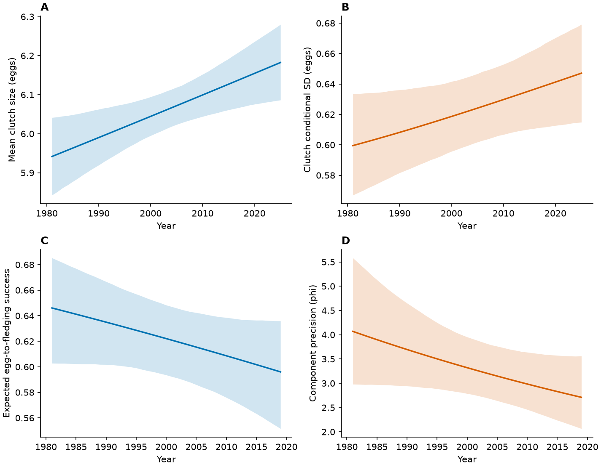

## Analysis sample and preparation

The temporal fits use the same curated trait-specific records, response distributions and random effects as the temperature models. The models were refitted with temperature removed from both location and scale.

<details class="analysis-code" open>
<summary>Show data-loading steps</summary>

```r
library(glmmTMB)
paths <- c(
  clutch = "glmmTMB_comparison_20261016/clutch_counts/COM_selected.rds",
  fledging = "zi_year_sensitivity_20261020/zi_year_selected.rds"
)
for (trait in names(paths)) {
  old <- readRDS(paths[trait])
  d <- readRDS(if (trait == "clutch")
    "glmmTMB_comparison_20261016/clutch_counts/data.rds" else
    "glmmTMB_comparison_20261016/analysis_data.rds")
  stopifnot(nobs(old) == nrow(d))
}
```

</details>

## Fit the calendar-year models

Calendar year, laying date and age enter both components; temperature is omitted. The original script also checks optimiser agreement and saves the selected `.rds` fits.

<details class="analysis-code">
<summary>Show model-fitting script (run locally)</summary>



</details>

These fits require the curated individual records and saved starting objects listed in [Data preparation](workflow.qmd). They are not run in the browser. The fitting script can be downloaded from the [project repository](R/83_fit_temporal_without_temperature.R).

## Read the saved output

The site displays the exported CSV files; the fit is not run when a page is opened.

<details class="analysis-code" open>
<summary>Show R code</summary>

```r
changes <- read.csv("tables/temporal_models_20261022/temporal_changes.csv")
fixed <- read.csv("tables/temporal_models_20261022/fixed_effects.csv")
changes
fixed
```

</details>

| trait | first_year | last_year | mean_first | mean_last | mean_change | mean_change_lower | mean_change_upper |
| --- | --- | --- | --- | --- | --- | --- | --- |
| clutch | 1981 | 2025 | 5.8377 | 6.2629 | 0.42515 | 0.26106 | 0.59682 |
| fledging | 1981 | 2019 | 0.67494 | 0.57201 | -0.10293 | -0.16349 | -0.040747 |

[Download CSV](tables/temporal_models_20261022/temporal_changes.csv)
<details class="analysis-code">
<summary>Show consistency contrasts</summary>

| trait | dispersion_ratio | dispersion_ratio_lower | dispersion_ratio_upper | response_SD_ratio | response_SD_ratio_lower | response_SD_ratio_upper |
| --- | --- | --- | --- | --- | --- | --- |
| clutch | 1.0643 | 0.93607 | 1.209 | 1.063 | 0.99393 | 1.1358 |
| fledging | 0.78001 | 0.51329 | 1.189 |  |  |  |


</details>

<details class="analysis-code">
<summary>Show saved output: fixed_effects.csv</summary>

| trait | model | component | term | estimate | SE | lower | upper |
| --- | --- | --- | --- | --- | --- | --- | --- |
| clutch | without_temperature | cond | (Intercept) | 1.7989 | 0.0044506 | 1.7902 | 1.8076 |
| clutch | without_temperature | cond | rel_LD | -0.008421 | 0.00024536 | -0.0089019 | -0.0079401 |
| clutch | without_temperature | cond | year_c | 0.0015977 | 0.00032546 | 0.00095977 | 0.0022356 |
| clutch | without_temperature | cond | age_classOLD | 0.030062 | 0.0023787 | 0.0254 | 0.034724 |
| clutch | without_temperature | disp | (Intercept) | -2.8105 | 0.033132 | -2.8755 | -2.7456 |
| clutch | without_temperature | disp | rel_LD | 0.052608 | 0.0029075 | 0.04691 | 0.058307 |
| clutch | without_temperature | disp | year_c | 0.001416 | 0.0015062 | -0.0015362 | 0.0043681 |
| clutch | without_temperature | disp | age_classOLD | -0.12622 | 0.035883 | -0.19655 | -0.055885 |
| fledging | without_temperature | cond | (Intercept) | 1.0815 | 0.073514 | 0.93739 | 1.2256 |
| fledging | without_temperature | cond | rel_LD | -0.075076 | 0.0045627 | -0.084019 | -0.066133 |
| fledging | without_temperature | cond | age_classOLD | 0.0080903 | 0.044813 | -0.079744 | 0.095925 |
| fledging | without_temperature | cond | year_c | -0.018067 | 0.0055458 | -0.028937 | -0.0071973 |
| fledging | without_temperature | zi | (Intercept) | -1.5537 | 0.092704 | -1.7354 | -1.372 |
| fledging | without_temperature | disp | (Intercept) | 1.1548 | 0.092256 | 0.97395 | 1.3356 |
| fledging | without_temperature | disp | rel_LD | -0.069589 | 0.0068985 | -0.08311 | -0.056068 |
| fledging | without_temperature | disp | age_classOLD | 0.025058 | 0.08422 | -0.14001 | 0.19013 |
| fledging | without_temperature | disp | year_c | -0.006538 | 0.0056549 | -0.017622 | 0.0045457 |

[Download CSV](tables/temporal_models_20261022/fixed_effects.csv)


</details>

## Export predictions and check the fits

<details class="analysis-code">
<summary>Show prediction-export script (run locally)</summary>



</details>

[Download trend-model fitting script](R/83_fit_temporal_without_temperature.R) · [Download prediction-export script](R/84_export_temporal_without_temperature.R)

<details class="analysis-code">
<summary>Show saved output: optimizer_comparison.csv</summary>

| trait | model | n | df | logLik | AIC | convergence | pdHess | scaled_gradient |
| --- | --- | --- | --- | --- | --- | --- | --- | --- |
| clutch | with_temperature | 12627 | 12 | -13769 | 27561 | 0 | TRUE | 0.00019347 |
| clutch | without_temperature_LBFGS | 12627 | 10 | -13777 | 27573 | 0 | TRUE | 9.6224e-06 |
| clutch | without_temperature_BFGS | 12627 | 10 | -13777 | 27573 | 0 | NA | 9.2348e-06 |
| fledging | with_temperature | 9790 | 15 | -16632 | 33294 | 0 | TRUE | 0.00036322 |
| fledging | without_temperature_LBFGS | 9790 | 13 | -16638 | 33301 | 0 | TRUE | 2.7277e-06 |
| fledging | without_temperature_BFGS | 9790 | 13 | -16638 | 33301 | 0 | TRUE | 2.9166e-06 |

[Download CSV](tables/temporal_models_20261022/optimizer_comparison.csv)


</details>

<details class="analysis-code">
<summary>Show saved output: temporal_simulation_checks.csv</summary>

| trait | target | group | n | statistic | observed | predicted | lower | upper |
| --- | --- | --- | --- | --- | --- | --- | --- | --- |
| clutch | conditional_plugin | overall | 12627 | mean | 6.1919 | 6.1957 | 6.1845 | 6.2072 |
| clutch | conditional_plugin | overall | 12627 | variance | 0.65595 | 0.56474 | 0.55011 | 0.57756 |
| fledging | conditional_plugin | overall | 9790 | mean | 0.58607 | 0.58139 | 0.57372 | 0.58901 |
| fledging | conditional_plugin | overall | 9790 | variance | 0.15455 | 0.15185 | 0.14954 | 0.15404 |
| fledging | conditional_plugin | overall | 9790 | zero_fraction | 0.23647 | 0.23131 | 0.2237 | 0.23958 |
| fledging | conditional_plugin | overall | 9790 | complete_success | 0.28856 | 0.28624 | 0.27799 | 0.29551 |

[Download complete CSV](tables/temporal_models_20261022/temporal_simulation_checks.csv)

</details>

## Rebuild the trend figure

The browser step below reads the saved prediction tables and draws the four trend panels. It does not refit the models.



## Figure



[PDF](figures/Fig4_COM_M1_time.pdf) · [Figure code — final chapter](figure_code.qmd#calendar-year-trends)

## Main conclusions

- Mean clutch size increased; egg-to-fledging success declined.
- Temporal changes in consistency were uncertain: clutch SD ratio 1.063 (0.994–1.136); fledging precision ratio 0.780 (0.513–1.189).
- Conditional variance remained underestimated in both traits; simulation checks condition on fitted parameters and group effects.
