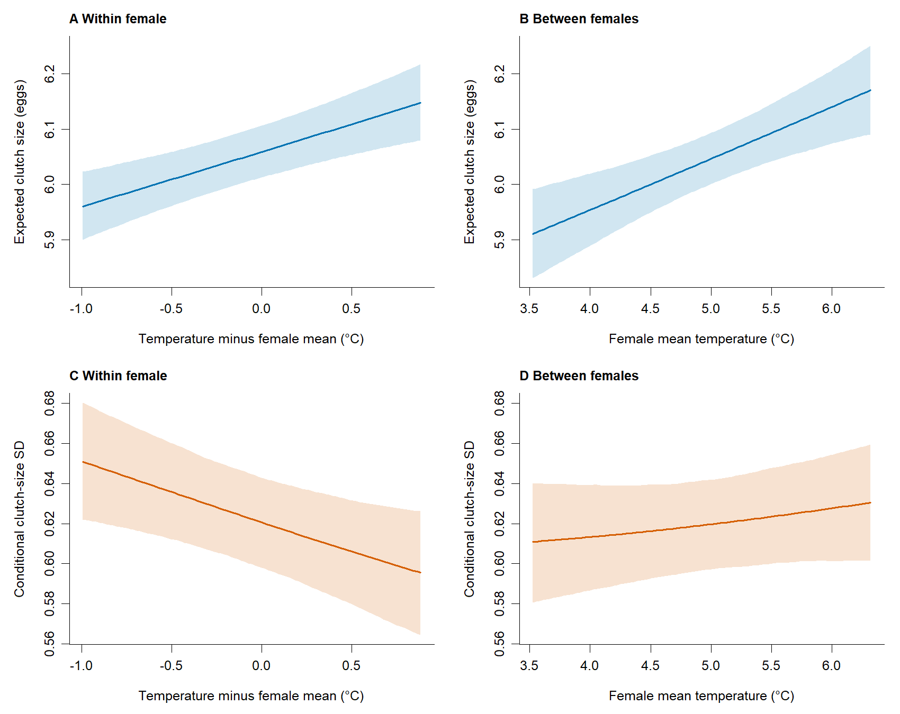
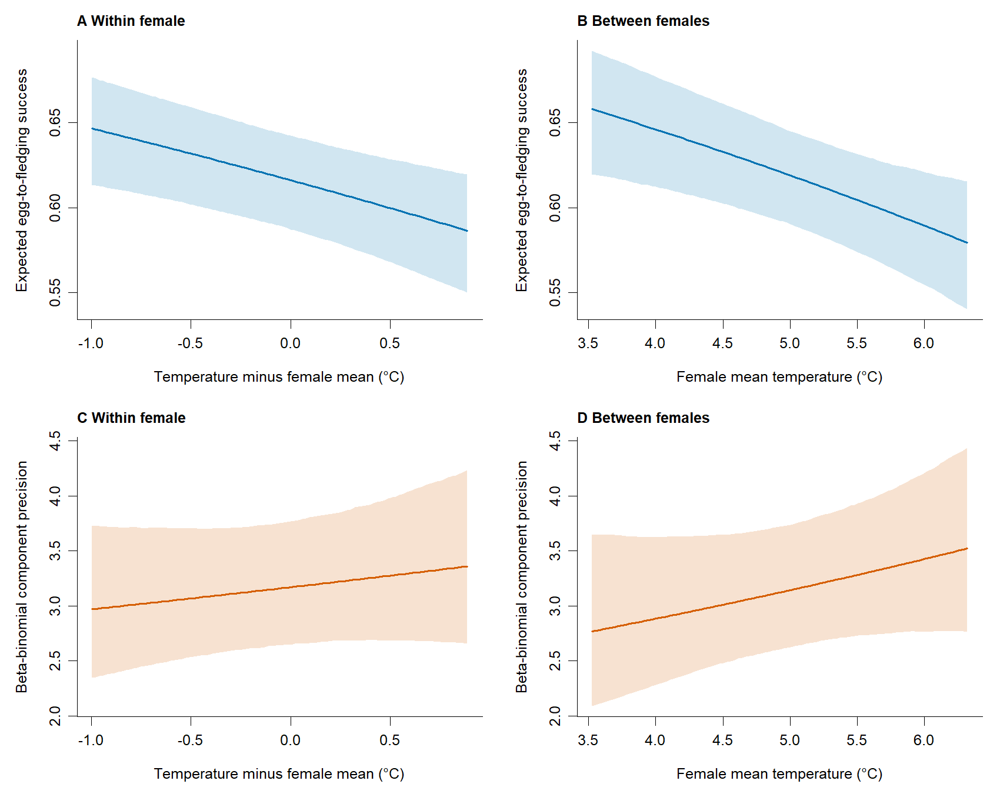

## Data preparation

This **additional model** separates temperature associations within the same female from differences between females. Temperature is split in both location and scale; continuous year, laying date, age and the existing random-effect structures are retained.

<details class="analysis-code" open>
<summary>Show temperature decomposition</summary>

```r
# d is the trait-specific analysis dataset; female means use its observed records.
centre <- unique(d$temp_mean - d$temp_mean_c)
d$temp_between <- ave(d$temp_mean, d$female_id, FUN = mean) - centre
d$temp_within <- d$temp_mean_c - d$temp_between
stopifnot(max(abs(d$temp_within + d$temp_between - d$temp_mean_c)) < 1e-8)
```

</details>

::: {.table-responsive}

| trait | records | females | seasons | Females with temperature variation | Their records |
| --- | --- | --- | --- | --- | --- |
| clutch | 12627 | 8894 | 44 | 2547 | 6278 |
| fledging | 9790 | 7132 | 39 | 1908 | 4566 |

:::

Single-record females have zero within deviation. The between predictor describes the seasons in which a female was observed, not a stable thermal preference.

## Fit the additional models

Clutch size uses COM-Poisson; fledging success uses zero-inflated beta-binomial. The extra-zero equation retains an intercept and year random effect, without temperature slopes.

<details class="analysis-code">
<summary>Show complete fitting and optimiser-check code</summary>



</details>

## Read saved results

<details class="analysis-code" open>
<summary>Show cached-output loading</summary>

```r
results <- readRDS("tables/within_between_20261026/aggregate_results.rds")
results$fixed_effects
results$contrasts
```

</details>

::: {.table-responsive}

| trait | component | term | estimate | lower | upper |
| --- | --- | --- | --- | --- | --- |
| clutch | cond | temp_within | 0.016474 | 0.0082647 | 0.024683 |
| clutch | cond | temp_between | 0.01542 | 0.0074873 | 0.023352 |
| clutch | disp | temp_within | -0.10139 | -0.16603 | -0.036745 |
| clutch | disp | temp_between | 0.0093495 | -0.033558 | 0.052257 |
| fledging | cond | temp_within | -0.20563 | -0.33654 | -0.074723 |
| fledging | cond | temp_between | -0.18323 | -0.30417 | -0.062296 |
| fledging | disp | temp_within | 0.065402 | -0.098944 | 0.22975 |
| fledging | disp | temp_between | 0.086186 | -0.051136 | 0.22351 |

:::

Location (`cond`): log clutch mean or logit beta-binomial mean. Scale (`disp`): log COM-Poisson inverse shape or log beta-binomial precision. Response-scale consistency curves below account for both clutch components.

[All fixed effects](tables/within_between_20261026/fixed_effects.csv) · [Aggregate RDS output](tables/within_between_20261026/aggregate_results.rds)

## Within versus between: direct tests

::: {.table-responsive}

| trait | component | estimate | lower | upper | p |
| --- | --- | --- | --- | --- | --- |
| clutch | cond | 0.0010541 | -0.0033865 | 0.0054948 | 0.64174 |
| clutch | disp | -0.11074 | -0.18821 | -0.033266 | 0.0050853 |
| fledging | cond | -0.022399 | -0.11145 | 0.066648 | 0.62201 |
| fledging | disp | -0.020784 | -0.18217 | 0.1406 | 0.80072 |

:::

Each contrast is **within minus between** on its component's link scale. A significant coefficient alongside a non-significant coefficient is not itself evidence that the effects differ.

## Comparison with the single-temperature model

::: {.table-responsive}

| trait | baseline AIC | within between AIC | delta AIC | LR | df | p |
| --- | --- | --- | --- | --- | --- | --- |
| clutch | 27561 | 27557 | -4.3056 | 8.3056 | 2 | 0.015721 |
| fledging | 33294 | 33298 | 3.7549 | 0.24505 | 2 | 0.88468 |

:::

Both members of each comparison were fitted under R 4.6.1 / glmmTMB 1.1.15.2. The baseline likelihoods were checked against the original final fits. Splitting temperature adds two fixed coefficients in total; the nested comparison tests equality of within and between effects in both components.

## Prediction export and checks

<details class="analysis-code">
<summary>Show prediction export and conditional-simulation code</summary>



</details>

<details class="analysis-code">
<summary>Numerical convergence and optimiser checks</summary>

::: {.table-responsive}

| trait | model | optimizer | convergence | pdHess | scaled gradient | logLik |
| --- | --- | --- | --- | --- | --- | --- |
| clutch | baseline | LBFGSB | 0 | TRUE | 0.00069105 | -13769 |
| clutch | baseline | BFGS | 0 | TRUE | 1.5695e-07 | -13769 |
| clutch | within_between | expanded_BFGS | 0 | TRUE | 1.4237e-06 | -13764 |
| clutch | within_between | whitened_NLMINB | 0 | TRUE | 1.4237e-06 | -13764 |
| fledging | baseline | LBFGSB | 0 | TRUE | 0.00013246 | -16632 |
| fledging | baseline | BFGS | 0 | TRUE | 1.044e-09 | -16632 |
| fledging | within_between | LBFGSB | 0 | TRUE | 0.00022226 | -16632 |
| fledging | within_between | BFGS | 0 | TRUE | 1.9068e-09 | -16632 |

:::

</details>

<details class="analysis-code">
<summary>Conditional simulation checks</summary>

::: {.table-responsive}

| trait | statistic | observed | predicted | lower | upper |
| --- | --- | --- | --- | --- | --- |
| clutch | mean | 6.1919 | 6.1961 | 6.1848 | 6.2075 |
| clutch | variance | 0.65595 | 0.56404 | 0.54822 | 0.57893 |
| clutch | fraction_six | 0.51231 | 0.51992 | 0.51009 | 0.52952 |
| clutch | outside_2_9 | 0 | 5.8077e-06 | 0 | 7.9195e-05 |
| fledging | mean_fraction | 0.58607 | 0.58075 | 0.57304 | 0.58827 |
| fledging | variance_fraction | 0.15455 | 0.15193 | 0.14954 | 0.15404 |
| fledging | complete_failure | 0.23647 | 0.23176 | 0.22322 | 0.23995 |
| fledging | complete_success | 0.28856 | 0.28582 | 0.27804 | 0.29377 |

:::

</details>

Observed statistics outside the conditional 95% simulation intervals: clutch: `variance`; fledging: `variance_fraction`. These discrepancies remain visible in the diagnostics.

<details class="analysis-code">
<summary>Fixed-design VIF</summary>

::: {.table-responsive}

| trait | predictor | VIF |
| --- | --- | --- |
| clutch | rel_LD | 1.0426 |
| clutch | temp_within | 1.0053 |
| clutch | temp_between | 1.3014 |
| clutch | year_c | 1.3121 |
| clutch | age_classOLD | 1.0557 |
| fledging | rel_LD | 1.0455 |
| fledging | age_classOLD | 1.0601 |
| fledging | temp_within | 1.0074 |
| fledging | temp_between | 1.3602 |
| fledging | year_c | 1.3691 |

:::

</details>

Simulation intervals use 300 plug-in datasets at fitted parameters and group modes; they are not cross-validation or parameter-uncertainty intervals. Full model and coefficient outputs are retained even when evidence is uncertain.

## Figures

Curves hold year and relative laying date at zero, age at yearling and all random effects at zero. Bands are pointwise 95% CIs from 4,000 joint coefficient draws. In the within panels, the female's mean temperature is held at the sample centre; in between panels, within deviation is zero.



[Clutch PDF](figures/Fig_within_between_clutch.pdf)



[Fledging PDF](figures/Fig_within_between_fledging.pdf) · [Figure code — final chapter](figure_code.qmd#temperature-within-between)

## Main results

- **Clutch size, location:** no clear within/between difference (direct contrast p = 0.642).
- **Clutch size, scale:** evidence of a within/between difference (direct contrast p = 0.00509).
- **Fledging success, location:** no clear within/between difference (direct contrast p = 0.622).
- **Fledging success, scale:** no clear within/between difference (direct contrast p = 0.801).

At the reference conditions above, for a +1°C change: mean differences are in eggs for clutch size and proportions for fledging success. Consistency ratios compare conditional SD or component precision after versus before that change.

::: {.table-responsive}

| trait | predictor | Mean change (95% CI) | consistency measure | Consistency ratio (95% CI) |
| --- | --- | --- | --- | --- |
| clutch | temp_within | 0.101 (0.0515, 0.151) | conditional_SD | 0.955 (0.920, 0.989) |
| clutch | temp_between | 0.0941 (0.0468, 0.142) | conditional_SD | 1.013 (0.990, 1.036) |
| fledging | temp_within | -0.0337 (-0.0576, -0.0122) | component_precision | 1.068 (0.911, 1.260) |
| fledging | temp_between | -0.0299 (-0.0503, -0.00989) | component_precision | 1.090 (0.949, 1.254) |

:::

## Interpretation

These are adjusted associations in a supplementary model. Lower clutch SD and higher fledging precision indicate greater consistency; fledging precision is conditional on component mean and clutch size. Between-female temperature differences may reflect sampling years and observation histories, so the decomposition does not establish causation or individual thermal preferences.

[Session information](tables/within_between_20261026/session_info.txt) · [Export session](tables/within_between_20261026/export_session_info.txt) · [Reference effects per degree](tables/within_between_20261026/reference_effects_per_degree.csv)
